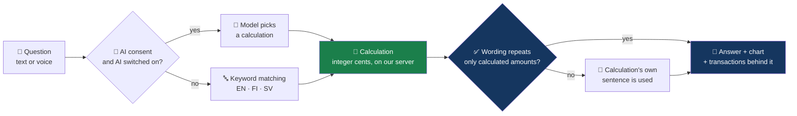
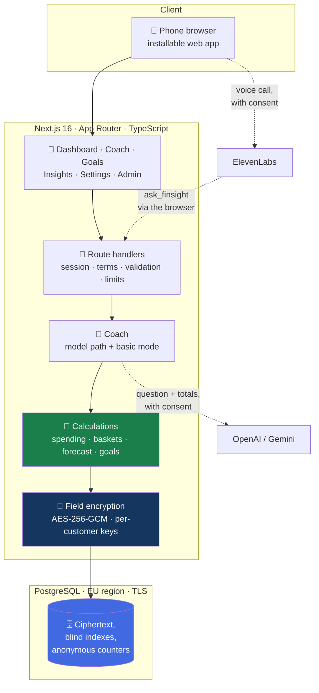
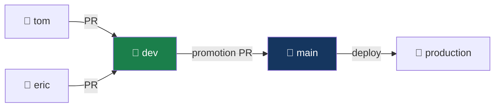

<div align="center">

# 💡 FinSight-AI

### A personal economic trainer you can talk to — every answer backed by your own transactions

**Junction 2026** · S-Pankki challenge: _Personal Economic Trainer_ · Open source

[](LICENSE)
[](docs/architecture.md)
[](docs/database.md)
[](docs/features.md)
[](.github/workflows/pr-validation.yml)
[](docs/security.md)

</div>

---

## What this is

Most people can see their transactions. Far fewer can say where their money actually goes,
what has to be protected before payday, or what a small change would be worth.

FinSight-AI is a mobile-first coach that answers those questions in plain language, by text
or by voice, in English, Finnish and Swedish. You ask; the service calculates the answer
from your transactions, shows the chart and the transactions behind the number, and lets
you change the assumptions.

<table>
<tr>
<td width="33%" valign="top">

### 🧭 Understand

_"Where does my money go?"_

Spending explained through three baskets, a money-flow diagram, and any chart you ask for.

</td>
<td width="33%" valign="top">

### 🛡️ Protect

_"What is safe to spend this week?"_

A conservative estimate that sets aside bills, essentials and a reserve first, and a
"Can I afford this?" check.

</td>
<td width="33%" valign="top">

### 🔭 Improve

_"I want to take the kids to Lapland."_

Savings goals from a sentence, a funding plan, personal recommendations and rewards for
real progress.

</td>
</tr>
</table>

> [!NOTE]
> A hackathon prototype on **synthetic data** supplied for the challenge. It is not connected
> to any real bank account, is not financial advice, and is not endorsed by or integrated
> with S-Pankki. Coupons, fees and adviser conversations are illustrations.

---

## 📊 What is built

|                    |                                                                                          |
| ------------------ | ---------------------------------------------------------------------------------------- |
| 🗣️ **Coach**       | Text chat and realtime voice calls; 12 calculations it can run; works with or without AI |
| 🌍 **Languages**   | English, Finnish, Swedish — interface, answers and speech                                |
| 📈 **Charts**      | Pie, bar, line and money-flow; the customer picks the type by asking or with a switch    |
| 🧩 **Dashboard**   | Widgets pinned from conversation, saved as named views, with a period filter             |
| 🎬 **Month story** | "My month in 30 seconds": a narrated, tap-through recap of last month                    |
| 🎯 **Goals**       | Set by describing them; planned from the customer's own monthly room                     |
| 🏆 **Rewards**     | Points, levels and example coupons for progress against one's own past                   |
| 👥 **Benchmarks**  | Age-group percentiles from the dataset, plus Statistics Finland 2022                     |
| 🥧 **Plans**       | Split income into five slices; share with friends as percentages only, never amounts     |
| 🔔 **Insights**    | Notifications in the app and on the device: shortfalls, habits, bills, goal reminders    |
| 🎓 **Teach**       | Staff write the answer for what the coach could not answer; it then gives it             |
| 🧑‍💼 **Adviser**     | Hand-over to a human, with a booked call; first conversation free                        |
| 🛠️ **Admin**       | Eleven sections, staff accounts with roles, charts, moderation, recycle bin, audit log   |
| 🔐 **Data**        | 5,100 customers and 3,626,755 transactions, every one encrypted per customer             |
| 🧪 **Tests**       | 88, including the real migrations on an in-memory PostgreSQL                             |

🎬 [Watch the 50-second demo](docs/media/finsight-demo.mp4) ([how it was made](video/README.md))

📖 [Feature guide](docs/features.md) · [How it works](docs/how-it-works.md) ·
[Admin guide](docs/admin-guide.md) ·
[Demo script](docs/demo-script.md)

---

## 🔁 How an answer is made

The model never does arithmetic and never sees a transaction. It chooses a calculation; the
service runs it and checks the model's wording against the result.



### The four ideas you need to read the code

<table>
<tr><td width="30">🧮</td><td>

**The service owns the numbers.** Every amount comes from a deterministic calculation in
integer cents. Chat, dashboard widgets, the language model and the voice agent all call the
same functions ([`src/lib/coach/registry.ts`](src/lib/coach/registry.ts)), so they cannot
disagree.

</td></tr>
<tr><td>🧺</td><td>

**Baskets have two dimensions.** Regularity _and_ necessity. Groceries are everyday
spending but they are not waste, and anything the rules cannot place stays visibly
unclassified.

</td></tr>
<tr><td>🔐</td><td>

**Nothing is stored bare.** Each customer's history is sealed with their own key before it
reaches the database. A dump, a backup or a database administrator sees ciphertext only.

</td></tr>
<tr><td>🕰️</td><td>

**The demo has its own clock.** The dataset ends in September 2026, so "last month" is
resolved against a server-owned as-of date, and nothing after it leaks into an estimate.

</td></tr>
</table>

---

## 🏗️ Architecture



📖 [Architecture](docs/architecture.md) · [Security](docs/security.md) ·
[Privacy](docs/privacy.md) · [Database](docs/database.md)

---

## 🚀 Getting started

Requires **Node.js 24** and **pnpm**.

```bash
git clone https://github.com/edarko265/FinSight-AI.git
cd FinSight-AI
git switch dev

pnpm install
cp .env.example .env.local        # then fill in; never commit it
```

Fill in `.env.local`. The minimum to run locally:

| Variable                                                   | How to get it                                              |
| ---------------------------------------------------------- | ---------------------------------------------------------- |
| `DATA_ENCRYPTION_KEY`, `BLIND_INDEX_KEY`, `SESSION_SECRET` | `openssl rand -base64 32`, one each                        |
| `DEMO_LOGIN_PASSWORD`                                      | Anything; it is the shared password for the demo customers |
| `ADMIN_PASSWORD`                                           | Anything locally; at least 12 characters in production     |

Everything else is optional: with no `DATABASE_URL` the app uses an embedded local database,
and with no AI key the coach answers in basic mode.

### 📦 Load the dataset

The bank's transaction file is ~363 MB and is never committed. Download it into `data/raw/`
(git-ignored), then load it, encrypted, into the database:

```bash
mkdir -p data/raw && cd data/raw
BASE=https://raw.githubusercontent.com/hackjunction/Junction-2026-S-pankki/main
curl -fLO $BASE/tx_customers_junction.csv
curl -fL https://media.githubusercontent.com/media/hackjunction/Junction-2026-S-pankki/main/tx_junction_transactions.csv \
  -o tx_junction_transactions.csv
head -c 200 tx_junction_transactions.csv   # must be CSV, not a Git LFS pointer
cd ../..

pnpm data:ingest --source data/raw         # all 5,100 customers, under a minute locally
pnpm db:check                              # confirms what is loaded
pnpm dev                                   # → http://localhost:3000
```

### 👤 Signing in

| Where    | With                                                                                                                                                                                                        |
| -------- | ----------------------------------------------------------------------------------------------------------------------------------------------------------------------------------------------------------- |
| `/login` | Any customer ID from the dataset (`CUST00001` … `CUST05100`) and `DEMO_LOGIN_PASSWORD`. Three are offered as examples: `CUST03707` (steady month), `CUST02226` (tight before payday), `CUST04630` (retired) |
| `/admin` | `ADMIN_PASSWORD`                                                                                                                                                                                            |

The first sign-in asks the customer to accept the terms of use and the privacy notice, and
to choose whether to use the AI coach.

### ⚙️ Commands

| Command                              | What it does                                                 |
| ------------------------------------ | ------------------------------------------------------------ |
| `pnpm dev`                           | Run locally                                                  |
| `pnpm check`                         | Lint, typecheck, test and build — exactly what CI runs       |
| `pnpm test`                          | 74 unit and integration tests                                |
| `pnpm db:migrate`                    | Apply pending database migrations                            |
| `pnpm db:check`                      | Connect to the configured database and report what is loaded |
| `pnpm data:ingest --source data/raw` | Load the dataset, encrypted                                  |
| `pnpm voice:setup`                   | Create the ElevenLabs voice agent and print its ID           |

---

## 🌿 How we work



Everyone works on their own branch and opens a pull request into `dev`. Only `dev` is
promoted to `main`. Every pull request runs lint, typecheck, tests, build and security
scans.

📖 [Branching](docs/branching-strategy.md) · [Coding conventions](docs/coding-conventions.md)
· [Contributing](CONTRIBUTING.md) · [Deployment](docs/deployment.md)

---

## 🗂️ Repository

```
FinSight-AI/
├── src/
│   ├── app/                  📱 pages and API routes (App Router)
│   │   ├── (app)/            signed-in area: dashboard, chat, goals, insights, settings…
│   │   ├── (auth)/           sign-in, password reset, privacy notice, terms
│   │   ├── admin/            staff dashboard
│   │   └── api/              route handlers
│   ├── components/           🎨 screens and shared UI (wizard, toasts, charts)
│   └── lib/
│       ├── analytics/        🧮 spending, baskets, forecast, recurrence, benchmarks
│       ├── coach/            🧠 calculations as tools, model path, basic mode, goals, grounding
│       ├── admin/            🛠️ settings, usage counters, audit, announcements
│       ├── advisor/          🧑‍💼 hand-over to a human adviser
│       ├── security/         🔐 field encryption, keys, sessions, rate limits
│       ├── data/             📦 ledger codec, repository, source parsing
│       ├── db/               🗄️ client and SQL migrations
│       ├── i18n/             🌍 English, Finnish, Swedish
│       └── voice/            🗣️ speech
├── scripts/                  ⚙️ ingestion, migrations, voice agent, checks
├── tests/                    🧪 unit and integration
├── docs/                     📚
└── .github/                  ⚙️ CI, security scans, deploy, templates
```

---

## 📚 Documentation

| Document                                           | What it answers                                         |
| -------------------------------------------------- | ------------------------------------------------------- |
| [Features](docs/features.md)                       | Everything a customer can do, screen by screen          |
| [How it works](docs/how-it-works.md)               | The logic step by step, with flowcharts; the statistics |
| [Admin guide](docs/admin-guide.md)                 | Each admin section, staff roles, teaching the coach     |
| [Demo script](docs/demo-script.md)                 | A three-minute walkthrough, and what to say             |
| [Architecture](docs/architecture.md)               | How an answer is made, the calculations, the API        |
| [Security](docs/security.md)                       | Encryption, sessions, customer isolation, AI boundaries |
| [Privacy](docs/privacy.md)                         | GDPR principles, consent, data rights, processors       |
| [Database](docs/database.md)                       | Why PostgreSQL, the tables, how it fits a bank          |
| [Deployment](docs/deployment.md)                   | Putting the app online: database, host and domain       |
| [Implementation plan](docs/implementation-plan.md) | What is done, what is left, who owns it                 |
| [Project scope](docs/FinSight-AI-Project-Scope.md) | The original requirements and data findings             |
| [Decisions](docs/decisions.md)                     | Open questions for the bank and what we decided         |
| [Coding conventions](docs/coding-conventions.md)   | How this codebase is written                            |
| [Branching strategy](docs/branching-strategy.md)   | Branches, pull requests, promotion                      |
| [GitHub setup](docs/github-setup-checklist.md)     | Repository settings and what is switched on             |

---

## 🎯 The challenge, and how we answer it

| Criterion                                | Weight | What the demo shows                                                                                |
| ---------------------------------------- | -----: | -------------------------------------------------------------------------------------------------- |
| 🎓 Impact on financial literacy          |    20% | Three baskets and a short lesson with every answer, in the customer's own numbers                  |
| 🤖 Originality of AI integration         |    20% | The model chooses calculations and is checked against them; goals from a sentence; realtime voice  |
| 📱 Clarity of the mobile user experience |    20% | Phone-first, three languages, step-by-step forms, dark mode, text size                             |
| 🏗️ Feasibility                           |    20% | Whole dataset ingested and encrypted, tested maths, works with AI switched off                     |
| 🔌 Potential to integrate into S-mobiili |    20% | Installable and embeddable web app, all data access behind one module, admin controls a bank needs |

---

## 👥 Team

Built at Junction 2026 by [@edarko265](https://github.com/edarko265),
[@tonix401](https://github.com/tonix401) and [@jenniferlab](https://github.com/jenniferlab).

---

<div align="center">

Released under the [MIT License](LICENSE). The S-Pankki dataset is **not** part of this
repository and is not covered by that licence. Statistics Finland data is used under
CC BY 4.0.

</div>
