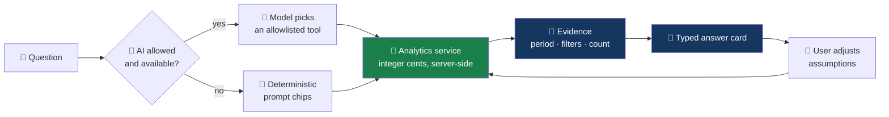
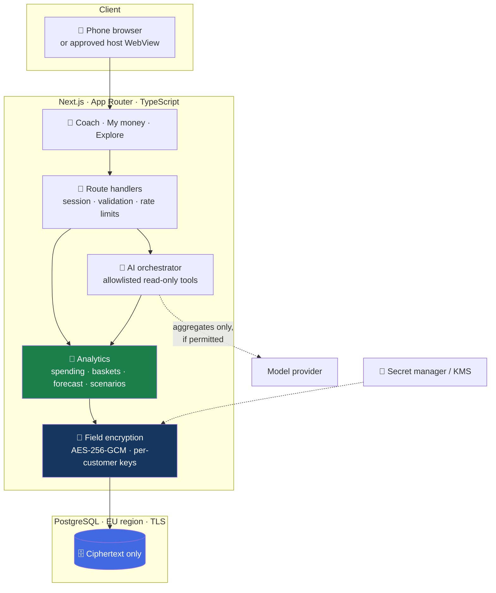
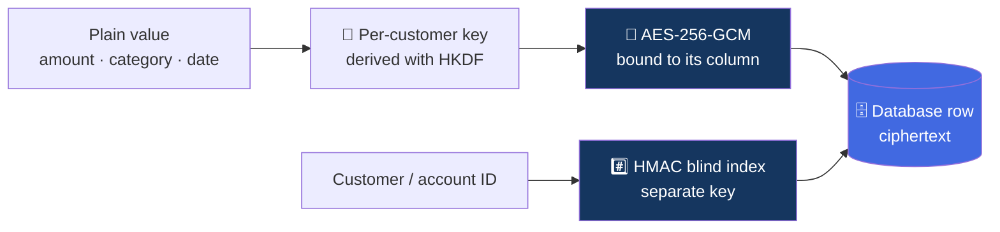
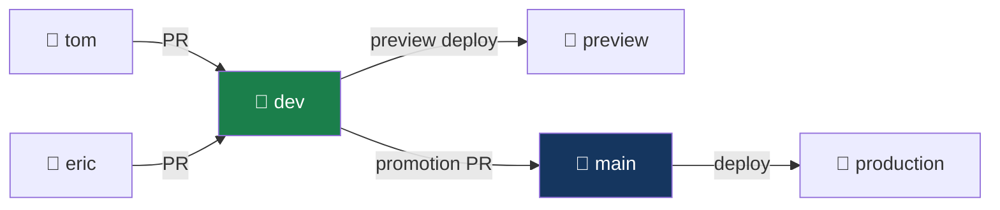

<div align="center">

# 💡 FinSight-AI

### An explainable financial coach — every answer backed by your own transaction evidence

**Junction 2026** · S-Pankki challenge: _Personal Economic Trainer_ · Open source

[](LICENSE)
[](#%EF%B8%8F-architecture)
[](docs/database.md)
[](.github/workflows/pr-validation.yml)
[](SECURITY.md)

</div>

---

## What this is

Most people can see their transactions. Far fewer can say where their money actually goes,
what has to be protected before the next payday, or what a small change would be worth.

FinSight-AI is a mobile-first coach that answers those questions in plain language. You ask;
it calculates the answer from your transactions, shows the evidence behind the number, and
lets you change the assumptions yourself.

<table>
<tr>
<td width="33%" valign="top">

### 🧭 Understand

_"Where does my money go?"_

Spending explained through three baskets, with the transactions behind every total one tap
away.

</td>
<td width="33%" valign="top">

### 🛡️ Protect

_"What can I spend this week?"_

A conservative estimate that sets aside bills and essentials first, and says so when it does
not have enough information.

</td>
<td width="33%" valign="top">

### 🔭 Explore

_"What if I cut restaurants by 20%?"_

What-if scenarios you can adjust with a slider. Always labelled hypothetical, never a
promise.

</td>
</tr>
</table>

> [!NOTE]
> This is a hackathon prototype built on **synthetic data** supplied for the challenge. It is
> not connected to any real bank account, is not financial advice, and is not endorsed by or
> integrated with S-Pankki.

---

## 🎯 The challenge

S-Pankki asks teams to turn a large synthetic transaction dataset into a trusted,
conversational financial coach that improves financial literacy.

|                        |                                                                              |
| ---------------------- | ---------------------------------------------------------------------------- |
| 💬 **Conversation**    | Natural-language questions about spending, habits, safe-to-spend and savings |
| 🧺 **Three baskets**   | Mandatory regular · mandatory irregular · everyday spending                  |
| 🎓 **Education first** | Explain, don't just report                                                   |
| 🔓 **MyData spirit**   | People explore their own data freely, not through fixed dashboards           |
| 📱 **Mobile**          | A mobile app, or a web app that can be embedded in one (S-mobiili potential) |
| 📊 **Optional**        | External benchmarks such as Statistics Finland                               |

### How we are judged, and how we answer

| Criterion                                | Weight | What the demo shows                                                       |
| ---------------------------------------- | -----: | ------------------------------------------------------------------------- |
| 🎓 Impact on financial literacy          |    20% | Three baskets explained with the user's own evidence                      |
| 🤖 Originality of AI integration         |    20% | Conversation produces evidence cards and scenarios, not unsupported prose |
| 📱 Clarity of the mobile user experience |    20% | Ask → understand → explore → act, on a phone                              |
| 🏗️ Feasibility                           |    20% | Real ingestion, deterministic maths, tested failure states                |
| 🔌 Potential to integrate into S-mobiili |    20% | Embeddable UI and a read-only banking data adapter                        |

---

## 🔁 How an answer is made

The model never does arithmetic and never sees raw transactions. It chooses a tool; the
application calculates.



### The three ideas you need to read the code

<table>
<tr><td width="30">🧮</td><td>

**The application owns the numbers.** Every amount shown comes from a deterministic
calculation in integer cents. The chart and the chat call the same functions, so they
cannot disagree.

</td></tr>
<tr><td>🧺</td><td>

**Baskets have two dimensions.** Regularity _and_ necessity. Groceries are everyday
spending but they are not waste, and anything ambiguous stays visibly _unclassified_
instead of being guessed.

</td></tr>
<tr><td>🕰️</td><td>

**The demo has its own clock.** The dataset ends in September 2026, so "last month" is
resolved against a server-owned as-of date, and nothing after that date leaks into an
estimate.

</td></tr>
</table>

---

## 🏗️ Architecture



### 🔒 Nothing is stored bare



Customer and transaction values are encrypted by the application before they reach the
database, and identifiers are replaced with keyed digests. A database dump, a backup or a
database administrator account on its own reveals nothing readable. Keys live in a secret
manager, never in the database or the repository.

📖 [Security model](docs/security.md) · [Database choice](docs/database.md)

---

## 🚀 Getting started

Requires **Node.js 24** and **pnpm**.

```bash
git clone https://github.com/edarko265/FinSight-AI.git
cd FinSight-AI
git switch dev

pnpm install
cp .env.example .env.local        # then fill in; never commit it
pnpm dev                          # → http://localhost:3000
```

Generate the encryption keys with `openssl rand -base64 32` (one per key).

### 📦 Getting the dataset

The bank's transaction file is ~363 MB and managed with Git LFS. Keep it **outside** this
repository; it is never committed.

```bash
git lfs install
git clone https://github.com/hackjunction/Junction-2026-S-pankki.git ../s-pankki-data
git -C ../s-pankki-data lfs pull
head -c 200 ../s-pankki-data/tx_junction_transactions.csv   # must be CSV, not an LFS pointer
```

### ✅ Before you push

| Gate             | Command                           | Why                                              |
| ---------------- | --------------------------------- | ------------------------------------------------ |
| 🎨 Lint & format | `pnpm lint` · `pnpm format:check` | Consistent code, fewer review comments           |
| 🧱 Types         | `pnpm typecheck`                  | Strict TypeScript, no `any`                      |
| 🧪 Tests         | `pnpm test`                       | Money and security logic is asserted to the cent |
| 🏗️ Build         | `pnpm build`                      | The production build must pass                   |
| 🟢 All of it     | `pnpm check`                      | Exactly what CI runs                             |

---

## 🌿 How we work



Everyone works on their own branch and opens a pull request into `dev`. Only `dev` is
promoted to `main`. Every pull request runs lint, typecheck, tests, build and security
scans before it can merge.

📖 [Branching](docs/branching-strategy.md) · [Coding conventions](docs/coding-conventions.md)
· [Contributing](CONTRIBUTING.md)

---

## 🗂️ Repository

```
FinSight-AI/
├── src/
│   ├── app/             📱 pages and route handlers (App Router)
│   └── lib/
│       ├── security/    🔐 field encryption, blind indexes
│       └── money.ts     🧮 integer-cent money handling
├── tests/               🧪 unit tests (Vitest)
├── docs/                📚 scope, plan, conventions, security
├── data/                📦 local-only, git-ignored bank data
└── .github/             ⚙️ CI, security scans, deploy, templates
```

---

## 📚 Documentation

| Document                                           | What it answers                                          |
| -------------------------------------------------- | -------------------------------------------------------- |
| [Implementation plan](docs/implementation-plan.md) | What we build, in what order, and who owns it            |
| [Project scope](docs/FinSight-AI-Project-Scope.md) | Full requirements, data findings and acceptance criteria |
| [Database](docs/database.md)                       | Why PostgreSQL, and how it fits a bank                   |
| [Security](docs/security.md)                       | Encryption, sessions, customer isolation, AI boundaries  |
| [Coding conventions](docs/coding-conventions.md)   | How this codebase is written                             |
| [Branching strategy](docs/branching-strategy.md)   | Branches, pull requests, promotion                       |
| [Decisions](docs/decisions.md)                     | Open questions for the bank and the answers we get       |
| [GitHub setup](docs/github-setup-checklist.md)     | Repository settings and what is switched on              |

---

## 👥 Team

Built at Junction 2026 by [@edarko265](https://github.com/edarko265),
[@tonix401](https://github.com/tonix401) and [@jenniferlab](https://github.com/jenniferlab).

---

<div align="center">

Released under the [MIT License](LICENSE). The S-Pankki dataset is **not** part of this
repository and is not covered by that licence.

</div>
