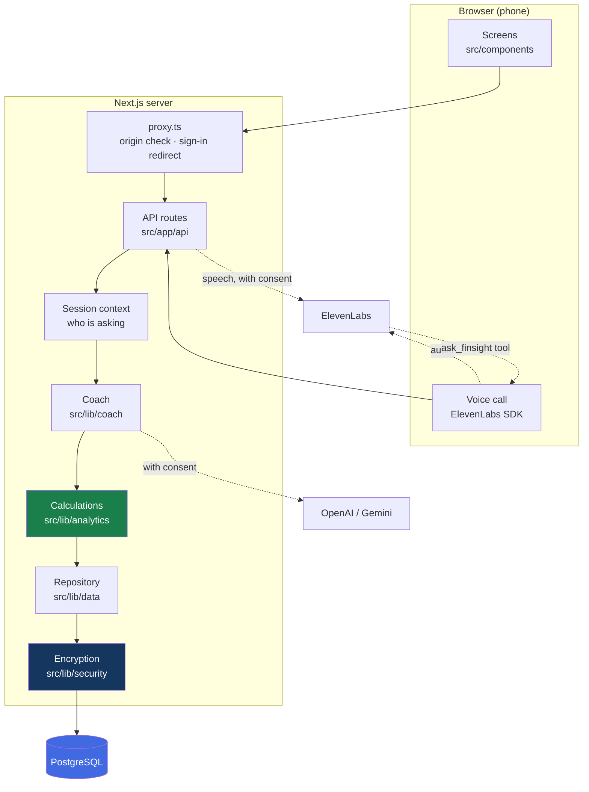
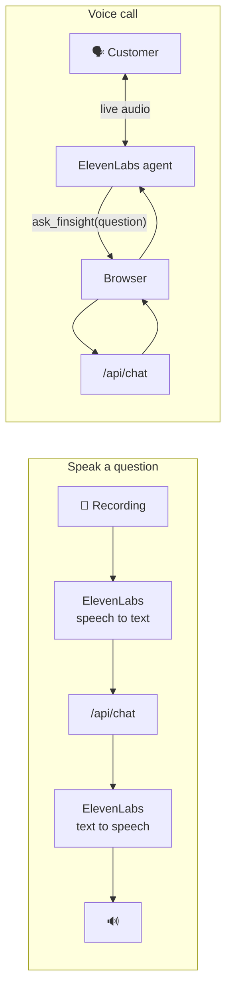

# Architecture

How a question becomes an answer, what the pieces are, and where each lives in the code.
For the rules and thresholds behind each calculation, with step-by-step flowcharts, see
[how-it-works.md](how-it-works.md).

---

## 1. The shape of it

One Next.js application: pages, API routes and server logic in one codebase, one PostgreSQL
database, and three outside services that are only used with the customer's consent.

## 2. A question, step by step

1. **The request arrives** at `POST /api/chat`. `proxy.ts` has already refused it if it came
   from another website.
2. **Who is asking** is read from the session cookie, never from the request
   ([`context.ts`](../src/lib/coach/context.ts)). The route refuses if the customer has not
   accepted the terms.
3. **The customer's data is loaded**: one row, fetched by blind index, decrypted in memory
   with that customer's key, and cut off at the demo date
   ([`repository.ts`](../src/lib/data/repository.ts)).
4. **A calculation is chosen.**
   - With AI consent and AI switched on, the model is given the question and a list of
     tools, and picks one ([`llm.ts`](../src/lib/coach/llm.ts)).
   - Otherwise, keywords in English, Finnish and Swedish pick it
     ([`router.ts`](../src/lib/coach/router.ts)).
5. **The calculation runs** on our server in integer cents and returns a finished result:
   text, a chart, the facts and a reference to the evidence
   ([`tools.ts`](../src/lib/coach/tools.ts), [`advice.ts`](../src/lib/coach/advice.ts)).
6. **The wording is checked.** If the model wrote the text, every euro amount in it must be
   one the calculation produced. If not, the model's text is dropped and the calculation's
   own sentence is used ([`grounding.ts`](../src/lib/coach/grounding.ts)).
7. **The answer is returned** with the chart, the facts, the evidence reference, the steps
   that produced it ([`steps.ts`](../src/lib/coach/steps.ts)) and the saved-widget query ([`answer.ts`](../src/lib/coach/answer.ts)).
8. **Only the topic is counted** for the admin statistics
   ([`usage.ts`](../src/lib/admin/usage.ts)).

If the model is off, slow, over its daily limit or returns an error, step 4 falls through to
keyword matching. The customer always gets an answer.

For a subject no calculation covers (loans, insurance, taxes), an answer that staff have
taught the coach is given first, word for word
([`taught.ts`](../src/lib/coach/taught.ts)).

## 3. The calculations

Every calculation is a "tool" with a validated input schema, registered in
[`registry.ts`](../src/lib/coach/registry.ts). Chat, dashboard widgets, the language model
and the voice agent all run them through the same two functions, `runTool` and `runQuery`.

| Tool            | Answers                                                                    | Chart                 |
| --------------- | -------------------------------------------------------------------------- | --------------------- |
| `spending`      | Total spending, overall or for one kind, in a period                       | Pie, or bars by month |
| `trend`         | Spending month by month                                                    | Bars or line          |
| `baskets`       | Regular bills, irregular essentials, everyday spending                     | Pie                   |
| `flow`          | Where income went                                                          | Money-flow            |
| `balance`       | Recorded balance now and at each month end                                 | Line                  |
| `safe_to_spend` | What is free after bills, essentials and a reserve; purchase checks        | Bars                  |
| `what_if`       | What a percentage cut would have saved                                     | Bars                  |
| `peers`         | Comparison with the same age group; Statistics Finland context             | Bars                  |
| `profile`       | Basket shares and largest free-choice categories                           | Bars                  |
| `recurring`     | Regular bills and the usual income pattern                                 | Bars                  |
| `recommend`     | Ranked suggestions with a monthly value                                    | Bars                  |
| `plan`          | The month as five slices of income, in percentages                         | Pie                   |
| `subscriptions` | Payments that repeat monthly at one merchant, with the yearly cost         | Rows                  |
| `accounts`      | Each account's balance, linked (simulated) ones included                   | Table                 |
| `safe_to_save`  | What could be set aside with the next month covered; tests an amount       | Split bar             |
| `mortgage`      | The customer's own mortgage application, for teaching                      | Split bar             |
| goals           | Save a goal, plan how to fund it ([`goals.ts`](../src/lib/coach/goals.ts)) | Bars                  |

A dashboard widget is a stored `{ tool, input, chart }`. It is re-run whenever it is shown,
so it always reflects the view's period and the customer's chosen chart type.

### Where the rules live

| What                                               | File                                                                                        |
| -------------------------------------------------- | ------------------------------------------------------------------------------------------- |
| Which transactions are spending, income, investing | [`classify.ts`](../src/lib/analytics/classify.ts)                                           |
| Which basket and how necessary                     | [`classify.ts`](../src/lib/analytics/classify.ts) — versioned rules, each with a reason     |
| Periods and the demo clock                         | [`periods.ts`](../src/lib/analytics/periods.ts)                                             |
| Sums, cash flow, balance                           | [`spending.ts`](../src/lib/analytics/spending.ts)                                           |
| Safe-to-spend                                      | [`forecast.ts`](../src/lib/analytics/forecast.ts)                                           |
| Regular bills and income                           | [`recurrence.ts`](../src/lib/analytics/recurrence.ts)                                       |
| What-if                                            | [`scenario.ts`](../src/lib/analytics/scenario.ts)                                           |
| Peer benchmarks                                    | [`benchmarks.ts`](../src/lib/analytics/benchmarks.ts)                                       |
| National context                                   | [`statfin.ts`](../src/lib/coach/statfin.ts), snapshot fetched by `scripts/fetch-statfin.ts` |
| Money parsing and formatting                       | [`money.ts`](../src/lib/money.ts)                                                           |

### Safe to spend, in one paragraph

Start from the recorded balance. Take off the protected buffer, a reserve for irregular
essentials and any planned purchase. Then walk forward day by day, taking off everyday
essentials and the bills that fall due. The lowest point reached is what is free; if it goes
below zero, that is the shortfall. Expected income is not counted until it arrives, so a
payday next week cannot hide a shortage this week.

## 4. Voice

Two ways to talk:

- **Speak a question** goes through our server for transcription and speech
  ([`elevenlabs.ts`](../src/lib/voice/elevenlabs.ts)).
- **A voice call** connects the browser to an ElevenLabs agent with a signed address our
  server issues. The agent has exactly one tool, `ask_finsight`, which runs in the
  customer's browser and calls `/api/chat` with their session. The agent itself has no
  credentials and no data: it hears the question and speaks the answer our coach returned
  ([`VoiceCall.tsx`](../src/components/voice/VoiceCall.tsx),
  [`setup-voice-agent.ts`](../scripts/setup-voice-agent.ts)).

## 5. API

Every route validates its input, takes the customer from the session, and returns JSON.
Routes marked 🔒 also require the terms to be accepted.

| Route                                                     | Method                   | Purpose                                                                                                        |
| --------------------------------------------------------- | ------------------------ | -------------------------------------------------------------------------------------------------------------- |
| `/api/auth/login`, `/api/auth/logout`                     | POST                     | Sign in and out                                                                                                |
| `/api/me`                                                 | GET                      | Who is signed in and which features are on                                                                     |
| `/api/consent`                                            | GET, POST                | Accept the terms; choose or withdraw AI                                                                        |
| 🔒 `/api/overview`                                        | GET                      | Balance, safe-to-spend, unread insights                                                                        |
| 🔒 `/api/chat`                                            | POST                     | Ask the coach                                                                                                  |
| 🔒 `/api/dashboard`                                       | GET, PUT                 | Saved views and their calculated widgets                                                                       |
| 🔒 `/api/transactions`                                    | GET                      | The transactions behind an answer                                                                              |
| 🔒 `/api/forecast`                                        | POST                     | Safe-to-spend with the customer's own assumptions                                                              |
| 🔒 `/api/goals`                                           | GET, POST, PATCH, DELETE | Goals, rewards, recommendations                                                                                |
| 🔒 `/api/insights`                                        | GET, POST                | Insights and announcements; mark as read                                                                       |
| 🔒 `/api/trash`                                           | GET, POST                | Recycle bin: restore, delete, empty                                                                            |
| 🔒 `/api/advisor`, `/api/advisor/messages`                | GET, POST                | Request an adviser; write to them                                                                              |
| 🔒 `/api/voice/stt`, `/api/voice/tts`, `/api/voice/agent` | POST, POST, GET          | Speech in, speech out, start a call                                                                            |
| `/api/privacy/export`, `/api/privacy/erase`               | GET, POST                | Download or delete the customer's data                                                                         |
| 🔒 `/api/accounts`                                        | GET, POST                | Accounts: link (simulated), rename, include, unlink                                                            |
| 🔒 `/api/corrections`                                     | GET, POST                | Basket corrections and bill adjustments, with undo                                                             |
| 🔒 `/api/goals/set-aside`                                 | POST, DELETE             | Mark money as set aside for a goal; take it back                                                               |
| 🔒 `/api/mortgage`                                        | GET                      | Mortgage guide figures and the customer's own application                                                      |
| 🔒 `/api/chat/history`                                    | GET, DELETE              | The saved conversation; clearing sends it to the recycle bin                                                   |
| 🔒 `/api/budgets`                                         | GET, POST                | Monthly limits and how the month is going against them                                                         |
| 🔒 `/api/friends`                                         | GET, POST                | Friend code, friends and the plans they share                                                                  |
| 🔒 `/api/notifications/prefs`                             | GET, PUT                 | Which notifications to send, and quiet hours                                                                   |
| 🔒 `/api/security/totp`                                   | GET, POST                | Two-step sign-in: set up, confirm, switch off                                                                  |
| 🔒 `/api/rewards`                                         | GET, POST                | Redeem a reward (bonus programme simulated)                                                                    |
| 🔒 `/api/plans`                                           | GET, POST                | Plans: make, edit, share by code, copy, preview                                                                |
| 🔒 `/api/push`                                            | GET, POST, DELETE        | Device notification subscriptions                                                                              |
| `/api/cron/reminders`                                     | GET                      | The daily reminder job (needs `CRON_SECRET`)                                                                   |
| `/api/admin/*`                                            | various                  | Staff sign-in, overview, settings, announcements, adviser queue, team, taught answers, shared plans, reminders |
| `/api/health`                                             | GET                      | Liveness and the deployed commit                                                                               |

## 6. Stack

| Layer       | Choice                                                 | Why                                                           |
| ----------- | ------------------------------------------------------ | ------------------------------------------------------------- |
| App         | Next.js 16 App Router, TypeScript strict               | One codebase for the mobile web app and its API               |
| UI          | Tailwind CSS 4, hand-written components and SVG charts | Small, accessible, no chart library to fight                  |
| Database    | PostgreSQL 17+ over TLS; embedded PGlite locally       | See [database.md](database.md)                                |
| Data access | Parameterised SQL through a small `Db` interface       | Five kinds of table do not need an ORM                        |
| Validation  | Zod on every boundary                                  | Requests, tool inputs, settings, environment                  |
| AI          | Vercel AI SDK with OpenAI and Google providers         | Tool calling behind a replaceable interface                   |
| Voice       | ElevenLabs speech and Agents                           | Human-sounding voice in three languages                       |
| Tests       | Vitest; PGlite for integration; Playwright with axe    | Real migrations in memory; browser tests on made-up customers |

## 7. What is deliberately simple

- **Demo sign-in.** Customer ID plus one shared password. A real deployment replaces it with
  the bank's authentication.
- **One real account per customer**, as in the dataset. Accounts at other banks are a
  labelled simulation; a real connection would replace the generator behind the same merge.
- **The demo clock is fixed** by `DEMO_AS_OF_DATE`.
- **Adviser chat polls** every few seconds instead of using a socket.
- **Conversations are kept for the customer only**, sealed with their key and capped at 60
  messages; they can clear them. The last few turns are sent with each question from the
  browser.
