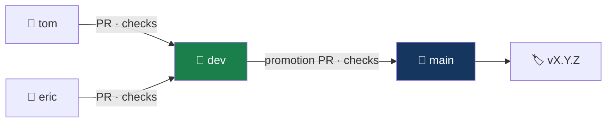

# Branching strategy — FinSight-AI

A protected, promotion-based model: personal branches merge into `dev`, and `dev` is
promoted to `main`.



---

## Branches

### `main`

- The released, demo-ready state. Always deployable.
- No direct commits or pushes.
- Updated **only** by a pull request from `dev` (or a `hotfix/*` branch in an emergency).
  CI rejects any other source.

### `dev`

- The integration branch. Everything meets here first.
- No direct commits. Updated only by pull requests.
- Deploys to the preview environment once deployment is switched on.

### `eric`, `tom`

- One long-lived personal branch per team member.
- Created from `dev`. Pull request target: **`dev`**.
- Push as often as you like; nobody else commits to your branch.

A teammate without a personal branch creates a short-lived `feature/<name>` or
`docs/<name>` branch from `dev` and opens a pull request the same way.

### `hotfix/<name>`

- For an urgent fix to `main` only. Branch from `main`, pull request into `main`, then
  merge `main` back into `dev` so the fix is not lost.

---

## Daily workflow

1. Start from the latest `dev`:
   ```bash
   git switch eric
   git pull
   git merge origin/dev
   ```
2. Work, commit, and check locally:
   ```bash
   pnpm check
   git push
   ```
3. Open a pull request — **base: `dev`**.
4. CI runs lint, format, typecheck, tests, build and security scans.
5. Merge with a **merge commit**. Personal branches are long-lived, and a merge commit
   keeps them in step with `dev`; squashing would make them diverge.
6. Keep going on the same branch. Merge `origin/dev` in again before the next piece of
   work.

## Promotion to `main`

1. `dev` is green and the milestone exit gate is met.
2. Open a pull request: `dev` → `main`.
3. Merge with a **merge commit** so the release boundary stays visible.
4. Tag it with the **Release — Tag** workflow (Actions → _Release — Tag_ → _Run
   workflow_), for example `v0.1.0`.

## Resolving conflicts

Resolve on your own branch, never on `dev`:

```bash
git switch tom
git merge origin/dev      # fix conflicts here
pnpm check
git push
```

## Rules summary

- ❌ No direct commits to `main` or `dev`.
- ❌ No pull requests into `main` from anything but `dev` (or `hotfix/*`).
- ❌ No force-pushes to `main` or `dev`.
- ✅ All work reaches `dev` through a pull request that passes CI.
- ✅ Commits are authored by the person who made them.
- ✅ Every promotion to `main` is tagged.
