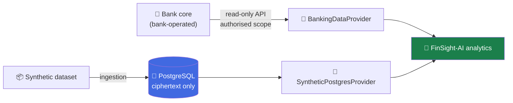

# Database — recommendation

**Recommendation: PostgreSQL, managed, hosted in an EU region, with application-level field
encryption on top.**

---

## Why PostgreSQL

| Need               | How PostgreSQL meets it                                                                                                                  |
| ------------------ | ---------------------------------------------------------------------------------------------------------------------------------------- |
| Correct money      | ACID transactions, strict types, `bigint` cents, constraints that reject bad rows                                                        |
| Bank acceptance    | A standard relational SQL database, widely run in regulated financial services; nothing exotic to justify to a bank's architecture board |
| Defence in depth   | TLS with certificate verification, role-based privileges, row-level security, audit extensions                                           |
| Portability        | Runs as a managed service on every major cloud and on-premises, so the bank chooses where it lives                                       |
| EU data residency  | Available in EU regions on every major provider, including Nordic regions                                                                |
| Bulk load          | `COPY` handles the 3.6 million-row transaction file in one pass                                                                          |
| Fit with the stack | First-class support in Next.js tooling and typed query layers                                                                            |
| Cost               | Open source, no licence fee, no lock-in                                                                                                  |

A document store or a vector database would be the wrong tool: the questions are structured
(filter, sum, compare periods), and the answers must reconcile to the cent.

## How this fits S-Pankki

S-Pankki's core banking runs on a platform provided by Crosskey, under an agreement that
covers Crosskey's banking solutions
([Crosskey case study](https://crosskey.fi/case-studies/s-pankki),
[partnership announcement](https://www.crosskey.fi/resources/s-bank-and-crosskey-extend-and-expand-their-cooperation-with-new-contract)).
Crosskey describes its stack as built on IBM iSeries
([Why Crosskey](https://www.crosskey.fi/company/why-us)). The database behind it is not
publicly documented, and we do not claim to know it.

That does not constrain our choice, and it should not: FinSight-AI is a **companion
service**, not part of the core. It would never connect to the core database. It reads
through a narrow, read-only interface that the bank controls:

Today the adapter is `SyntheticPostgresProvider`. In a pilot it would be swapped for a
`BankApiProvider` without touching the analytics. PostgreSQL is the store for our own
service's data, which is the part a bank would expect us to own.

## Where to host it

| Stage      | Choice                                                                                     | Notes                                                                       |
| ---------- | ------------------------------------------------------------------------------------------ | --------------------------------------------------------------------------- |
| Hackathon  | Managed serverless PostgreSQL in an EU region (for example Neon, Frankfurt)                | Free tier, branching for dev and preview, connection pooling for serverless |
| Bank pilot | Managed PostgreSQL inside the bank's own cloud tenancy or data centre, Nordic or EU region | Same schema and code; only `DATABASE_URL` and the key source change         |

Use **PostgreSQL 17**. Keep `dev` and `main` on separate databases (or branches) with
separate credentials and separate encryption keys.

## Bank-grade setup

1. **Encrypt everything sensitive in the application** before it is written. The database
   holds ciphertext and blind indexes only. See [security.md](security.md).
2. **TLS always**, `sslmode=verify-full`. No plaintext connections, including local tunnels
   to hosted databases.
3. **Least-privilege roles**, never the owner role at runtime:
   - `finsight_migrator` — owns schema, used only by migrations
   - `finsight_ingest` — insert into staging and transaction tables, used only by ingestion
   - `finsight_app` — select on data, write only to sessions and assumptions
4. **Row-level security** as a second line behind application scoping.
5. **Keys outside the database**, in the platform secret store now and a KMS or HSM later.
6. **Encrypted backups with point-in-time recovery**, and a tested restore.
7. **Audit trail** of ingestions and schema changes; migrations are versioned and reviewed.
8. **No production data in development.** Each environment has its own data and keys.

## Shape of the data

Each customer's whole transaction history is stored as **one sealed value**: the rows are
packed, compressed and encrypted with that customer's own key. The database cannot see how
many transactions a customer has, what they bought, or when.

| Table              | Plain columns                                         | Encrypted or hashed                                                                                                 |
| ------------------ | ----------------------------------------------------- | ------------------------------------------------------------------------------------------------------------------- |
| `ingestions`       | id, source file, checksum, status, counts, timestamps | —                                                                                                                   |
| `customer_ledgers` | key ID, ingestion ID                                  | customer blind index, sealed profile (customer ID, account ID, age, postal code), sealed ledger (every transaction) |
| `customer_state`   | kind, updated-at                                      | customer blind index, sealed value (dashboard, read insights, consent)                                              |
| `sessions`         | expiry                                                | SHA-256 token hash, customer blind index                                                                            |
| `peer_benchmarks`  | age band, metric, group size, percentiles             | — (anonymous group statistics; groups under 30 are dropped)                                                         |

Money is integer cents. Source row order is kept as the tie-breaker for equal timestamps.

A request fetches one row by blind index, decrypts it in memory and runs the analytics in
the application. The full dataset (5,100 customers, 3.6 million transactions) ingests in
about 25 seconds and occupies roughly 300 MB.

## Query layer

Hand-written, parameterised SQL through a small `Db` interface
([`src/lib/db/client.ts`](../src/lib/db/client.ts)); migrations are plain `.sql` files
applied by `pnpm db:migrate`. With `DATABASE_URL` set the app connects to PostgreSQL over
TLS; without it, an embedded PostgreSQL (PGlite) under `data/derived/` is used so the
project runs locally with no external service. All access goes through repository functions
that take the customer's blind index from the server session.
