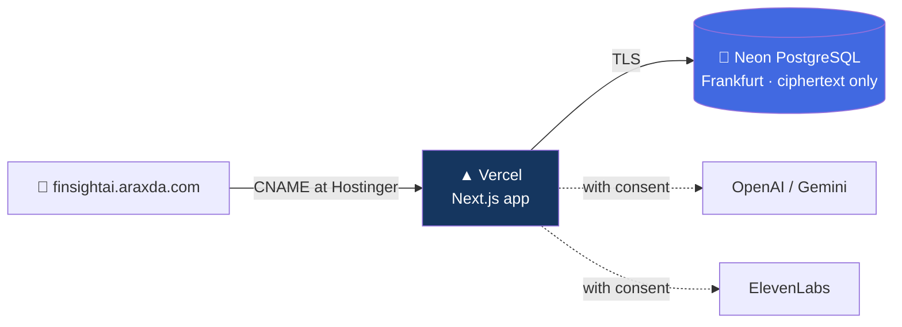

# Deployment — FinSight-AI

How to put the app online at a subdomain such as `finsightai.araxda.com`, so the team and
the judges can use it. Three pieces: a database (Neon), a host (Vercel) and a DNS record
(Hostinger).



## 1. Database — Neon

1. Create the project: region **AWS Europe Central 1 (Frankfurt)**, **Postgres database on**,
   every other service off (object storage, functions, AI gateway, realtime, auth are not used).
2. Copy the **pooled** connection string and append `?sslmode=verify-full` if it is not there.
3. Load the data from your machine, once:

   ```bash
   DATABASE_URL='postgresql://…?sslmode=verify-full' pnpm data:ingest --source data/raw
   ```

   This applies the migrations and writes all 5,100 customers, encrypted. It must run with
   the **same** `DATA_ENCRYPTION_KEY` and `BLIND_INDEX_KEY` the deployed app will use,
   otherwise the app cannot read what was written.

## 2. Host — Vercel

1. Import the GitHub repository into Vercel. Framework: Next.js. Production branch: `main`.
2. Add the environment variables below (Settings → Environment Variables), for Production
   and Preview. Copy the values from your `.env.local`; never commit them.

   | Variable                                                                    | Notes                                                                       |
   | --------------------------------------------------------------------------- | --------------------------------------------------------------------------- |
   | `DATABASE_URL`                                                              | The Neon pooled string                                                      |
   | `DATA_ENCRYPTION_KEY`, `DATA_ENCRYPTION_KEY_ID`, `BLIND_INDEX_KEY`          | Same values used for ingestion                                              |
   | `SESSION_SECRET`                                                            | Any 32 random bytes, base64                                                 |
   | `AI_PROCESSING_ALLOWED`, `AI_PROVIDER`, `OPENAI_API_KEY` / `GEMINI_API_KEY` | AI coach                                                                    |
   | `ELEVENLABS_API_KEY`, `ELEVENLABS_AGENT_ID`                                 | Voice                                                                       |
   | `DEMO_MODE=true`, `DEMO_AS_OF_DATE=2026-09-15`, `DEMO_LOGIN_PASSWORD`       | Demo sign-in                                                                |
   | `ADMIN_PASSWORD`                                                            | Choose a strong one for a public deployment                                 |
   | `APP_BASE_URL`                                                              | `https://finsightai.araxda.com`                                             |
   | `VAPID_PUBLIC_KEY`, `VAPID_PRIVATE_KEY`                                     | Device notifications. Generate once with `npx web-push generate-vapid-keys` |
   | `CRON_SECRET`                                                               | Any long random string. Vercel sends it to the daily reminder job           |

3. Deploy.

## 3. Domain — Hostinger

1. In Vercel: Project → Settings → Domains → add `finsightai.araxda.com`. Vercel shows the
   record to create.
2. In Hostinger: Domains → `araxda.com` → DNS records → add
   **Type** `CNAME`, **Name** `finsightai`, **Target** the value Vercel shows
   (normally `cname.vercel-dns.com`), TTL default.
3. Wait for Vercel to show the domain as valid; it issues the TLS certificate itself.

## 4. Continuous deployment

Once Vercel is connected to the repository it deploys `main` to production and every pull
request to a preview address by itself. The `deploy.yml` workflow in this repository is an
alternative that deploys from GitHub Actions; leave `DEPLOY_ENABLED` unset when using
Vercel's own integration, so there is only one deployer.

CI (`pr-validation.yml`, `security.yml`) runs on every pull request into `dev` or `main`.

## After a schema change

Migrations are not run by the deployment. When a pull request adds a file under
`src/lib/db/migrations`, apply it to the hosted database from your machine, with
`DATABASE_URL` pointing at it:

```bash
pnpm db:migrate
pnpm db:check
```

The app keeps working with older data while a migration is pending only if the new code
does not need the new table yet, so apply migrations **before** promoting to `main`.

## Voice call

The realtime voice call needs an ElevenLabs agent. It is created once:

```bash
pnpm voice:setup          # prints an agent id
```

Put the ID in `ELEVENLABS_AGENT_ID`, locally and in Vercel. The API key needs these
permissions: Text to Speech, Speech to Text, Voices (read) and ElevenAgents (write).

## Before sharing the link

- Change `ADMIN_PASSWORD` and `DEMO_LOGIN_PASSWORD` from the local defaults.
- Set a daily AI limit in Admin → Controls, so a shared link cannot run up a bill.
- In demo mode the sign-in page shows the demo password on purpose. Anyone with the link
  can sign in as a synthetic customer; there is no real data behind it.
- Rate limits are per server instance. They slow abuse down but are not a hard cap; the
  daily AI limit is.
