# How it works — the logic, step by step

This page shows how FinSight-AI reaches its conclusions: how a question becomes an answer,
how a transaction lands in a basket, how "safe to spend" is worked out, and how the
statistical data is used. Every rule and threshold here is the one in the code, and each
section names the file it lives in.

Two principles hold everywhere:

- **The language model never calculates.** It chooses which calculation to run and writes
  the sentence around the result. The numbers come from deterministic code.
- **Money is integer cents.** No floating-point amounts; rounding happens once, at a named
  step.

---

## 1. From a question to an answer

[`answer.ts`](../src/lib/coach/answer.ts) · [`router.ts`](../src/lib/coach/router.ts) ·
[`llm.ts`](../src/lib/coach/llm.ts) · [`grounding.ts`](../src/lib/coach/grounding.ts) ·
[`taught.ts`](../src/lib/coach/taught.ts)

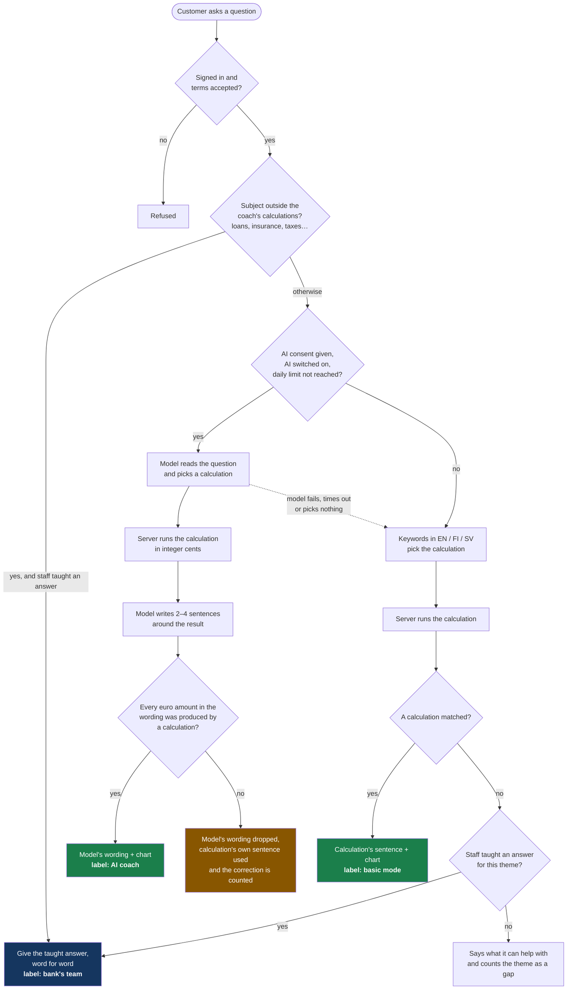

### How keywords choose a calculation (basic mode)

The question is lower-cased and tested against patterns in a fixed order. The first match
wins, which is why the more specific intents come first.

| Order | If the question mentions…                                    | Calculation                      |
| ----- | ------------------------------------------------------------ | -------------------------------- |
| 1     | a goal ("save for", "I want to…", an amount and a purpose)   | Save a goal, or list goals       |
| 2     | "what if", "cut", "reduce", or any percentage                | What-if                          |
| 3     | "safe to spend", "can I afford" (+ an amount)                | Safe to spend / purchase check   |
| 4     | "budget", "my plan", "split my income"                       | Plan (the month as five slices)  |
| 5     | "flow", "where does my income go"                            | Money flow                       |
| 6     | "compare", "people my age", "average"                        | Peer comparison                  |
| 7     | "what kind of spender", "habits"                             | Spending pattern                 |
| 8     | "baskets", "essential", "mandatory"                          | Three baskets                    |
| 9     | "balance", "how much do I have"                              | Balance                          |
| 10    | "trend", "over time", "per month"                            | Trend                            |
| 11    | a category or merchant kind (taxis, restaurants, groceries…) | Spending on that                 |
| 12    | "recommend", "advice", "what should I"                       | Recommendations                  |
| 13    | "bills", "recurring", "payday"                               | Regular bills and income         |
| 14    | "where", "breakdown", "spent"                                | Spending by category             |
| —     | nothing above                                                | No calculation (see section 1.2) |

The period ("last month", "6 months", "this month") and the chart type ("as a pie",
"viivakaaviona") are picked out of the same sentence by their own patterns.

### 1.1 The grounding check

After the model writes, [`checkGrounding`](../src/lib/coach/grounding.ts) finds every euro
amount in its text (`€1,011.45`, `1 011,45 €`, `300 euros`) and looks each one up in the set
of amounts the calculations returned.

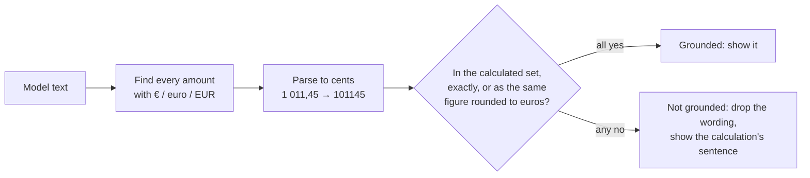

The admin area counts how often F happens.

### 1.2 What happens when the coach has no answer

Each question is sorted into a theme (loans, investing, insurance, cards, taxes, pension,
benefits, account, budgeting, other) by [`themes.ts`](../src/lib/admin/themes.ts). **Only
the theme is counted; the question is not stored.** Staff see the counts under _Teach the
coach_, write the answer the coach should have given, and from then on the coach gives it.

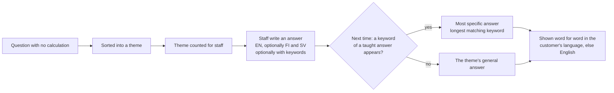

Nothing is generated from a taught answer: what staff approved is what customers read.

---

## 2. How a transaction is categorised

[`classify.ts`](../src/lib/analytics/classify.ts) — rule version `2026-11-14.1`

Each transaction in the bank's data has a **type**, a **category** and sometimes a
**merchant category code** (MCC). Those three decide everything.

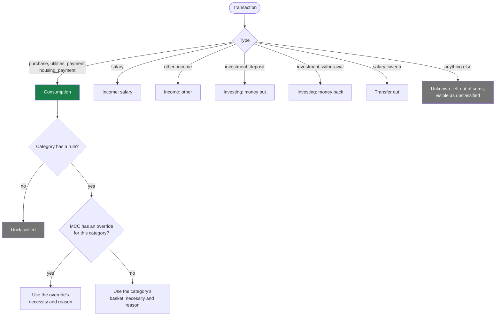

Only consumption is ever placed in a basket. Salary, investing and transfers are never
counted as spending.

Every result carries a **reason** in plain words (for example _"Taxis are everyday spending
you can usually choose"_), which the app shows when the customer opens the evidence.

## 3. How the three baskets were made

The challenge brief describes three kinds of spending. The rules map the dataset's ten
categories onto them, and add a second dimension the brief implies: **how necessary** it is.

| Category       | Basket               | Necessity   | MCC overrides                                        |
| -------------- | -------------------- | ----------- | ---------------------------------------------------- |
| Housing        | Regular bills        | Essential   | —                                                    |
| Utilities      | Regular bills        | Essential   | —                                                    |
| Health         | Irregular essentials | Essential   | —                                                    |
| Home & Tech    | Irregular essentials | Unknown     | Home supplies (5200), hardware (5251) → Essential    |
| Groceries      | Everyday spending    | Essential   | —                                                    |
| Transportation | Everyday spending    | Essential   | Taxis (4121) → Free choice; parking (7523) → Unknown |
| Restaurants    | Everyday spending    | Free choice | —                                                    |
| Entertainment  | Everyday spending    | Free choice | —                                                    |
| Lifestyle      | Everyday spending    | Free choice | —                                                    |
| Travel         | Everyday spending    | Free choice | —                                                    |

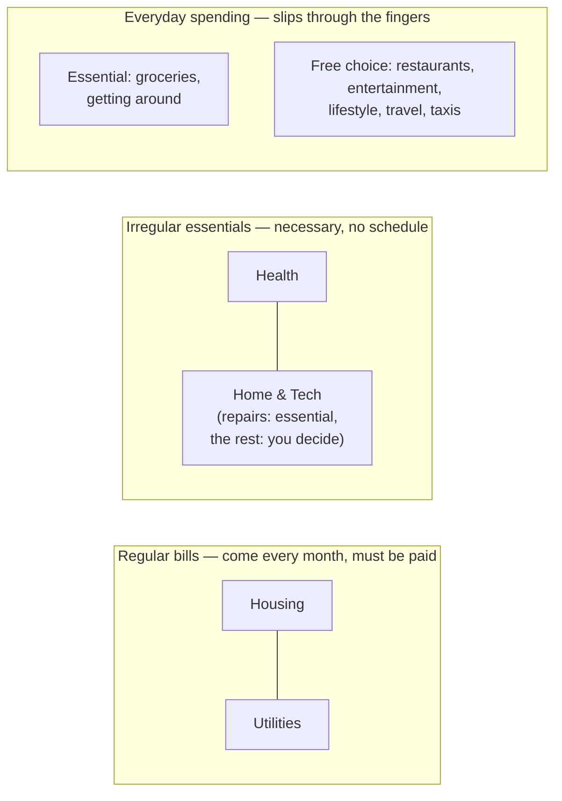

Why this shape:

- **"Unknown" is a real answer.** A new laptop may be a need or a treat; the data cannot
  tell. The rules say so instead of guessing, and the coach never calls it waste.
- **Essentials are never suggested as savings.** Recommendations and what-ifs draw only
  from _free choice_ spending.
- **The rules are a proposal, not a bank definition.** They are versioned, so a change
  is visible, and each carries its reason.

---

## 4. Safe to spend

[`forecast.ts`](../src/lib/analytics/forecast.ts)

The question is: _how much could I spend now without running short before the end of the
period?_ The answer is deliberately cautious.

### 4.1 Where the starting assumptions come from

| Assumption                  | How it is suggested from the customer's own history                                  |
| --------------------------- | ------------------------------------------------------------------------------------ |
| Everyday essentials per day | Essential everyday spending over the last **3** full months ÷ the days in them       |
| Reserve for irregular costs | Mean monthly essential irregular spending over the last **12** months × horizon ÷ 30 |
| Bills on a date             | Regular bills usually paid once a month whose next date falls inside the horizon     |
| Bills spread over the month | Regular bills paid several times a month, as a daily amount (monthly ÷ 30)           |
| Protected buffer            | 0 unless the customer sets one                                                       |
| Expected income             | Found, but **not counted** unless the customer switches it on                        |

The customer can change every one of them.

### 4.2 The walk forward

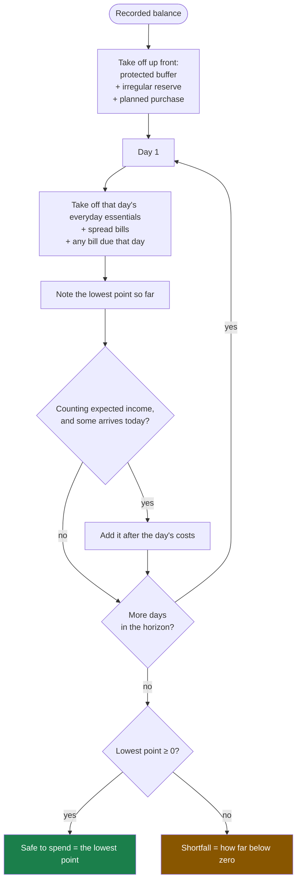

Why the **lowest point** and not the end balance: a payday on day 6 must not hide a rent
payment on day 3. Costs on a day are taken before income on the same day for the same
reason.

With fewer than three months of history the result is "not enough data", not a number.

### 4.3 A worked example

Balance €1,400 on the 15th, 7-day horizon. History suggests €18 a day of everyday
essentials, €40 irregular reserve, and rent of €600 due on the 18th.

| Step             | Calculation       | Running  |
| ---------------- | ----------------- | -------- |
| Start            | balance           | €1,400   |
| Up front         | − €40 reserve     | €1,360   |
| Days 16, 17      | − 2 × €18         | €1,324   |
| Day 18           | − €18 − €600 rent | €706     |
| Days 19–22       | − 4 × €18         | €634     |
| **Lowest point** |                   | **€634** |

Safe to spend: about €634. Ask "can I afford a €700 bike?" and €700 is taken off up front:
the lowest point becomes −€66, so the answer is "that would leave you about €66 short".

---

## 5. Regular bills and income

[`recurrence.ts`](../src/lib/analytics/recurrence.ts)

The dataset has no payee names, so recurrence is inferred per **kind** of payment and shown
as a suggestion.

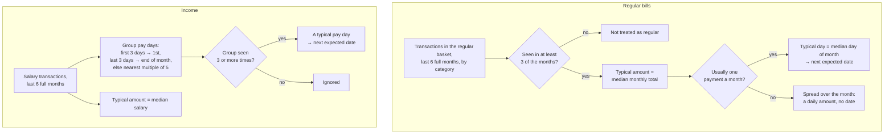

The **median** is used, not the mean, so one unusual month (a back-payment, a double bill)
does not shift the suggestion.

## 6. What-if

[`scenario.ts`](../src/lib/analytics/scenario.ts)

"What if I cut restaurants by 20%?"

1. Sum what was spent on the target in the baseline period, in cents.
2. Saving = baseline × percentage, done in basis points (20% = 2,000) and rounded once.
3. New total = baseline − saving. Over a year = monthly saving × 12.

It is always described as hypothetical: what the cut **would have** been worth.

---

## 7. Goals

[`advice.ts`](../src/lib/coach/advice.ts) — `planGoal`

A goal is a name, an amount and a number of months. The monthly amount is the target ÷
months, rounded up.

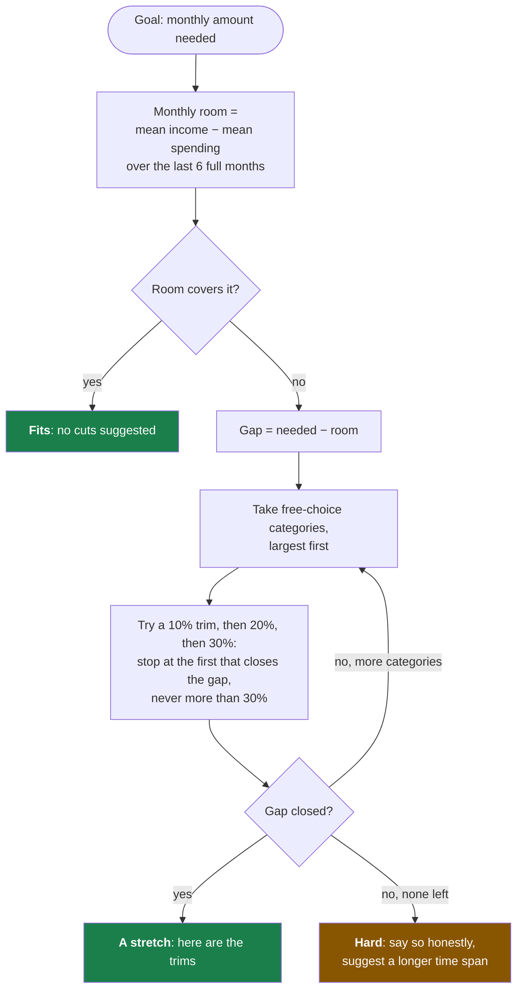

Essentials are never trimmed to make a goal fit.

## 8. Recommendations

[`advice.ts`](../src/lib/coach/advice.ts) — `buildRecommendations`

Six rules run over the customer's data. Each that applies produces a suggestion with an
estimated monthly value; the list is sorted by that value and the top five are shown.

| #   | Rule fires when…                                                                   | Suggestion                                  | Monthly value                  |
| --- | ---------------------------------------------------------------------------------- | ------------------------------------------- | ------------------------------ |
| 1   | A free-choice category is above the 75th percentile of the customer's age group    | Move halfway towards the group's middle     | (own − group median) ÷ 2       |
| 2   | The largest free-choice category is over €50 a month (and rule 1 did not cover it) | A modest trim                               | 15% of it                      |
| 3   | 8 or more free-choice purchases under €15 last month                               | Notice the small ones                       | 25% of their total             |
| 4   | There were essential irregular costs in the last 12 months                         | Set aside a reserve                         | Protection, shown as €0 saving |
| 5   | The balance is below one month of regular bills                                    | Build a one-month buffer                    | Protection                     |
| 6   | More than €100 is left each month and nothing is invested                          | Put the surplus to work (no product advice) | Protection                     |

## 9. Rewards

[`advice.ts`](../src/lib/coach/advice.ts) — `buildRewards`. Point values and coupon
thresholds are set by staff in Admin → Controls.

The voucher ladder (`buildRewards().vouchers`, maths in
[`vouchers.ts`](../src/lib/analytics/vouchers.ts)) has three tiers, bronze, silver and gold,
with targets of regular income × max(national saving rate, 3 %) × 1, 2 or 3. Each tier offers
a grocery voucher (5, 10 or 15 % off one product at the group's grocery stores) or a fuel
voucher (5, 10 or 15 cents per litre off one top-up at its fuel stations). A stored pick with
an id from an earlier version of the ladder is read as no pick.

| Achievement               | Earned when…                                                | Default points   |
| ------------------------- | ----------------------------------------------------------- | ---------------- |
| A lighter month           | Last month's spending < the mean of the three months before | 75               |
| Free-choice spending down | Last month's free-choice spending ≤ 90% of that mean        | 75               |
| A buffer                  | Balance ≥ one month of regular bills                        | 100              |
| Months with money left    | 2+ months in a row where income exceeded spending           | 20 a month, to 6 |
| Investing                 | Something was invested last month                           | 50               |
| A goal                    | At least one goal is set                                    | 25               |

Levels: Starter 0, Bronze 100, Silver 200, Gold 350. **Every comparison is with the
customer's own past**, never with other people.

---

## 10. Insights and reminders

[`insights.ts`](../src/lib/coach/insights.ts) ·
[`all-insights.ts`](../src/lib/coach/all-insights.ts) ·
[`reminders.ts`](../src/lib/push/reminders.ts)

| Insight                         | Fires when…                                                                                             | Tone    |
| ------------------------------- | ------------------------------------------------------------------------------------------------------- | ------- |
| Possible shortfall              | The 7-day safe-to-spend walk goes below zero                                                            | Warning |
| Thin buffer                     | Balance is below one month of regular bills                                                             | Warning |
| **A habit going the wrong way** | From the 7th of the month: a free-choice category is ≥ €30 **and** ≥ 25% ahead of the same days usually | Warning |
| Bill due                        | A regular bill is expected within 10 days                                                               | Info    |
| Category spike                  | Last month ≥ 25% and ≥ €30 above its three-month mean                                                   | Info    |
| Small purchases add up          | 8+ free-choice purchases under €15 last month                                                           | Info    |
| Reserve                         | There were essential irregular costs in the last 12 months                                              | Info    |
| Above the age group             | A free-choice category is above the 75th percentile for the age group                                   | Info    |
| **Goal reminder**               | Once a month for each goal: the amount to put aside                                                     | Info    |
| Category drop                   | Last month ≥ 25% and ≥ €30 below its mean                                                               | Good    |
| Announcement                    | Staff published one                                                                                     | As set  |

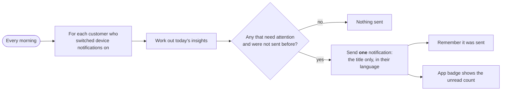

The notification text never contains an amount: amounts are shown only inside the app,
after sign-in.

---

## 11. Plans, and sharing them without sharing amounts

[`plan-math.ts`](../src/lib/coach/plan-math.ts) · [`plans.ts`](../src/lib/coach/plans.ts)

A plan splits a month's income into five slices: **regular bills, irregular essentials,
everyday spending, saving, investing**, in whole percentages that add up to 100.

### 11.1 Your month as a plan

1. Take the last **3** full months.
2. Mean income; mean of each basket; mean invested.
3. Saving = income − the three baskets − investing (never below zero).
4. Turn the five amounts into percentages with the **largest-remainder method**: round
   each share down, then give the leftover points to the shares that lost most by
   rounding. The result always adds up to exactly 100.

### 11.2 What sharing publishes

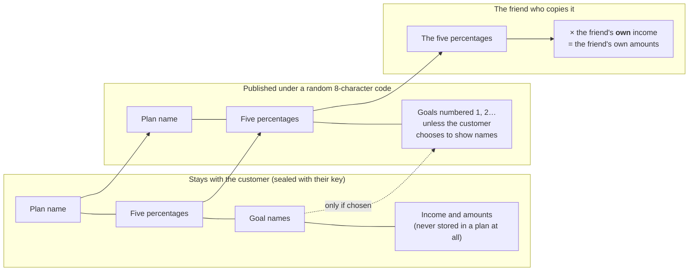

Guarantees, each enforced in code and covered by a test:

- A plan has **no field that could hold an amount**. Percentages are whole numbers.
- A plan name containing a currency sign or three or more digits in a row is refused.
- The published record holds **no customer reference**: it cannot be traced back to the
  sharer, even by staff. The owner's own sealed copy remembers the code.
- The record is encrypted at rest like everything else.
- Editing the plan updates what is shared; unsharing or moving it to the recycle bin
  removes it at once.
- Looking up codes is rate-limited so they cannot be guessed in bulk.

One honest limit: if a friend already knows one of your amounts (say, your rent), the
percentages let them estimate the rest. Whole-percentage rounding blurs this but does not
remove it, and the share screen shows exactly what will be visible before anything is
published.

---

## 11b. Linked accounts, corrections, saving and the mortgage guide

[`linked-accounts.ts`](../src/lib/data/linked-accounts.ts) ·
[`personal.ts`](../src/lib/coach/personal.ts) ·
[`recurrence.ts`](../src/lib/analytics/recurrence.ts) ·
[`goal-progress.ts`](../src/lib/coach/goal-progress.ts)

### One picture of the customer

Everything the customer adds on top of the bank's records is applied in one place, before
any calculation runs, so every tool sees the same picture.

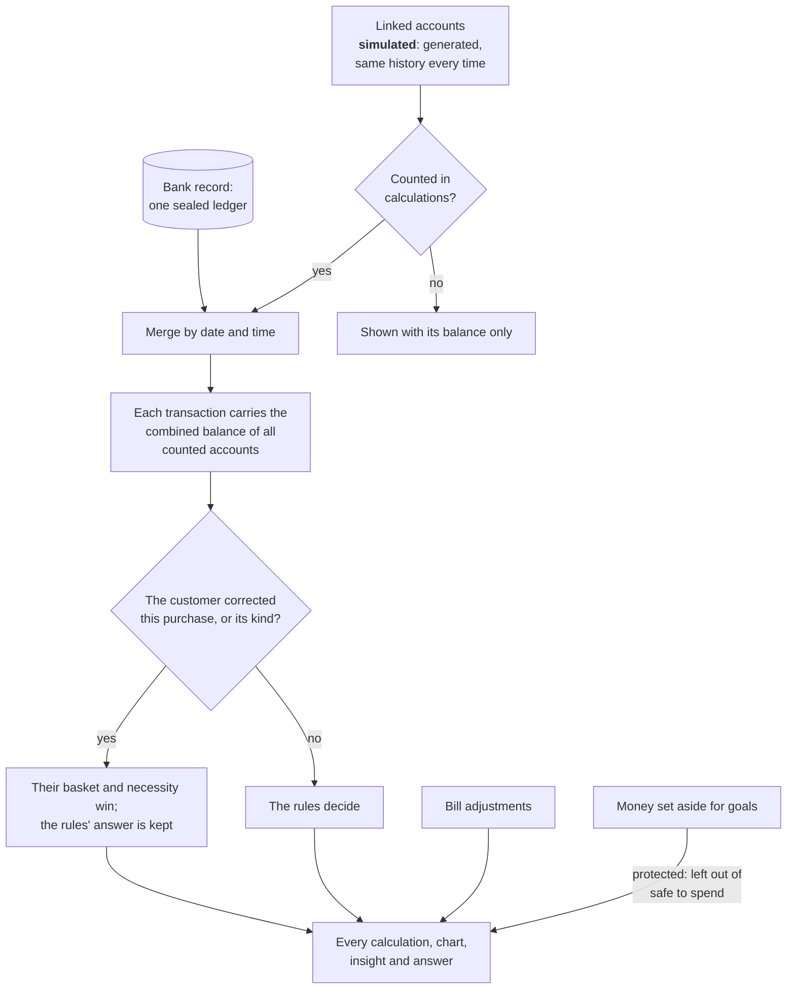

- **Linked accounts are a simulation.** The generator is seeded by the customer and the
  account, so the same account always has the same history and nothing needs storing but
  the link itself. Any chart that includes one says so in its source note.
- **The combined balance** is the sum of the latest balance of each counted account; a
  credit card's balance is negative, so it reduces the total.
- **A correction** can cover one purchase or every purchase of the same category and
  merchant code. The single purchase wins over the kind; both win over the rules.

### Subscriptions

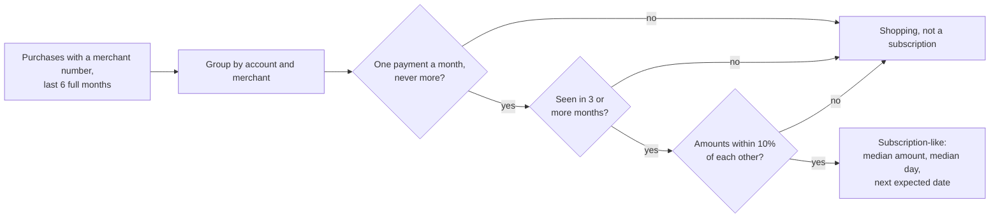

The data has no payee names, so a subscription is named by its category and the last
characters of its merchant number. It is a suggestion, not a fact.

### Safe to save, and goal progress

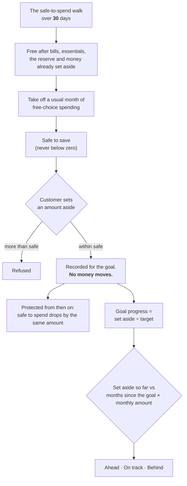

"Safe to save" keeps a month of the customer's usual free-choice spending in place on
purpose: saving should not mean an empty wallet the week after.

### The mortgage guide

The dataset has an event history for 200 mortgage applications and each one's outcome.
They are used for teaching only.

| What                                | How it is worked out                                                         |
| ----------------------------------- | ---------------------------------------------------------------------------- |
| Typical length                      | Median days from the first event to the last, with the shortest and longest  |
| Typical number of steps, properties | Medians per application                                                      |
| When a step typically happens       | Median day, counted from the start, of that step's first occurrence          |
| How often a step happens            | Share of applications in which it appears                                    |
| Costs along the way                 | Per cost type: share of applications that recorded it, and the median amount |
| Typical loan and own-money share    | Medians of loan ÷ price and own money ÷ price                                |
| Why not approved                    | Counts of the recorded reasons among the applications that were turned down  |

A customer whose ID is linked to an application gets their own events and outcome, sealed
with their key like everything else they own; the free-text notes in the source are not
kept. **Nothing here predicts an outcome**, and the coach is instructed never to judge
whether a loan would be approved.

---

## 12. How the statistical data is used

Three different bodies of numbers are used, for three different jobs. None of them is ever
mixed into a customer's own figures.

```mermaid
flowchart TD
    subgraph own["A. The customer's own history"]
        O1[Their transactions] --> O2["Means and medians over<br/>3, 6 or 12 full months"]
        O2 --> O3[Safe to spend, bills, goals,<br/>insights, rewards, plans]
    end
    subgraph peers["B. The bank's dataset as a whole"]
        P1["5,100 synthetic customers<br/>3.6 million transactions"] --> P2[Per customer: average month<br/>over 12 full months, per metric]
        P2 --> P3["Per age band: 25th, 50th and<br/>75th percentile of those averages"]
        P3 --> P4{Group has<br/>30 or more?}
        P4 -- no --> P5[Dropped]
        P4 -- yes --> P6[(Stored: percentiles only)]
        P6 --> P7[Peer comparison, one insight,<br/>one recommendation, one admin chart]
    end
    subgraph nat["C. Statistics Finland"]
        N1["Household budget survey,<br/>table 14q4, year 2022"] --> N2[Snapshot file in the repository]
        N2 --> N3["Shown as context under<br/>a peer comparison. Decides nothing."]
    end
```

### A. The customer's own history

| Statistic                   | Method                                   | Window               | Used for                              |
| --------------------------- | ---------------------------------------- | -------------------- | ------------------------------------- |
| Monthly room                | Mean income − mean spending              | 6 full months        | Goal fit, "idle money" recommendation |
| Everyday essentials per day | Total ÷ days                             | 3 full months        | Safe to spend                         |
| Irregular reserve           | Mean monthly total                       | 12 full months       | Safe to spend, reserve suggestion     |
| A bill's typical amount     | **Median** monthly total                 | 6 full months        | Bills due, buffer checks              |
| A bill's typical day        | **Median** day of month                  | 6 full months        | Bill-due insight, safe to spend       |
| Typical salary              | **Median** salary                        | 6 full months        | Expected income                       |
| A category's usual month    | Mean                                     | 3 months before last | Spike and drop insights               |
| Usual spending so far       | Mean of the same days                    | 3 previous months    | "Habit going the wrong way"           |
| The month as a plan         | Mean, then largest-remainder percentages | 3 full months        | Plans                                 |

Means are used where the typical level matters; **medians where a single odd month must
not distort the result**. "Full months" means completed calendar months before the demo
date, so a half-finished month never drags an average down.

### B. Peer benchmarks from the dataset

Built once, when the data is loaded ([`ingest.ts`](../scripts/ingest.ts),
[`benchmarks.ts`](../src/lib/analytics/benchmarks.ts)):

1. For each customer, average monthly cents over the last 12 full months for each
   **metric**: total consumption, each of the three baskets, income, invested, and each of
   the ten categories.
2. Place the customer in an **age band**: 18–24, 25–34, 35–44, 45–54, 55–64, 65+, and
   also in "all".
3. For each band and metric, take the **25th, 50th and 75th percentile** of those
   averages (nearest-rank method).
4. **Drop any group with fewer than 30 customers.**
5. Store only: band, metric, group size, the three percentiles. No row describes a person.

How a customer is placed against their group:

| Their average month is…   | Wording              |
| ------------------------- | -------------------- |
| below the 25th percentile | Lower than most      |
| between 25th and 75th     | In the typical range |
| above the 75th percentile | Higher than most     |

Where the benchmarks are used:

- **"How do I compare with people my age?"** — the customer's figure against the middle
  half of their age band, with the group size stated under the chart.
- **One insight** — a category above the 75th percentile.
- **One recommendation** — move halfway from the customer's figure to the band's median.
- **One admin chart** — median monthly spending by age band.

Why percentiles and not an average: a few very high spenders pull a mean up, and "you
spend less than average" would then be true of most people. The middle half is a fairer
picture of "typical".

Why age and nothing else: age and postal code are the only personal attributes in the
dataset. Postal code is not used for grouping: groups would become small enough to point
at individuals.

### C. National context from Statistics Finland

|                |                                                                                                  |
| -------------- | ------------------------------------------------------------------------------------------------ |
| **Source**     | Statistics Finland, Households' consumption, table **14q4** (household budget survey)            |
| **Year**       | 2022, table last updated April 2024, fetched 13 November 2026                                    |
| **Measure**    | Consumption expenditure **per consumption unit**, current prices, euros per month                |
| **Licence**    | CC BY 4.0                                                                                        |
| **Fetched by** | [`scripts/fetch-statfin.ts`](../scripts/fetch-statfin.ts), saved as a snapshot in the repository |

"Per consumption unit" adjusts a household's spending for its size, which makes it the
closest published figure to one adult's spending.

Only five of our categories are close enough to a national (COICOP) division to compare:

| Our category   | COICOP division                     |
| -------------- | ----------------------------------- |
| Groceries      | 01 Food and non-alcoholic beverages |
| Health         | 06 Health                           |
| Transportation | 07 Transport                        |
| Entertainment  | 09 Recreation and culture           |
| Restaurants    | 11 Restaurants and accommodation    |

The survey's age groups (17–24, 25–34 … 85+) are matched to the customer's age.

How it is used: **as one line of context** under a peer comparison, with the year and the
caveat that one account is not a whole household and the categories differ slightly. It is
never used to rank a customer, trigger an insight, or produce a recommendation. The app
never calls the Statistics Finland service while answering: it reads the saved snapshot.

### D. Statistics about usage (for staff)

Counted per day: the topic of a question, the language, and whether AI, basic mode or a
taught answer replied. **Not** who asked, the wording, or the time of day. See
[admin-guide.md](admin-guide.md).

---

## 13. What the AI is and is not given

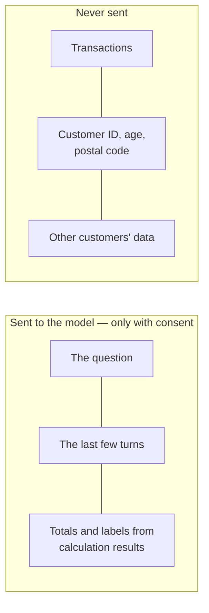

Without consent nothing is sent anywhere, and the coach works in basic mode.

## 14. Where to look in the code

| Topic                      | File                                                   | Tests                                         |
| -------------------------- | ------------------------------------------------------ | --------------------------------------------- |
| Classification and baskets | `src/lib/analytics/classify.ts`                        | `tests/unit/analytics.test.ts`                |
| Safe to spend              | `src/lib/analytics/forecast.ts`                        | `tests/unit/analytics.test.ts`                |
| Bills and income           | `src/lib/analytics/recurrence.ts`                      | `tests/unit/analytics.test.ts`                |
| Peer benchmarks            | `src/lib/analytics/benchmarks.ts`                      | `tests/unit/analytics.test.ts`                |
| Routing, goals, grounding  | `src/lib/coach/router.ts`, `advice.ts`, `grounding.ts` | `tests/unit/coach.test.ts`                    |
| Plans and sharing          | `src/lib/coach/plan-math.ts`, `plans.ts`               | unit and `tests/integration/database.test.ts` |
| Taught answers, staff      | `src/lib/coach/taught.ts`, `src/lib/admin/staff.ts`    | `tests/integration/database.test.ts`          |
