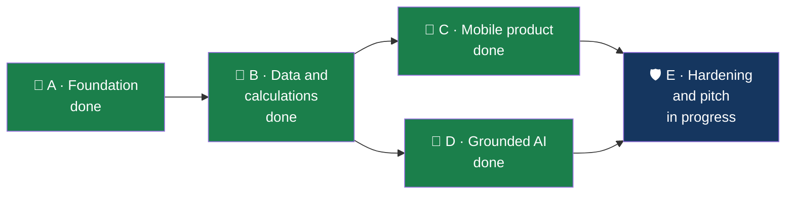

# Implementation plan — FinSight-AI

Where the build stands, what is left, and who owns it. The
[project scope](FinSight-AI-Project-Scope.md) remains the source of the original
requirements (P0-01 … P0-12).

Updated 14 November 2026.

---

## Where we are

Everything below is on the `eric` branch. It has not yet been merged to `dev` or `main`, so
CI has not run on it and the deployed site does not have it.

## The scope's P0 requirements

| ID    | Requirement                                      | Status | Where                                                                    |
| ----- | ------------------------------------------------ | ------ | ------------------------------------------------------------------------ |
| P0-01 | Synthetic demo session; no cross-customer access | ✅     | Session cookie, blind-index lookup, tools without a customer parameter   |
| P0-02 | Reproducible ingestion                           | ✅     | `scripts/ingest.ts`: streaming, BOM, checksum, LFS-pointer check, report |
| P0-03 | Spending questions                               | ✅     | `spending`, `trend`; evidence sheet                                      |
| P0-04 | Three baskets                                    | ✅     | `baskets`; every purchase in exactly one, totals reconcile (tested)      |
| P0-05 | Spending estimate                                | ✅     | `safe_to_spend`; shortfall shown separately                              |
| P0-06 | What-if saving                                   | ✅     | `what_if`; exact to the cent (tested)                                    |
| P0-07 | Evidence and teaching                            | ✅     | Transactions behind every figure; a lesson with each answer              |
| P0-08 | Mobile conversation                              | ✅     | Checked at 390 px and 320 px, no sideways scroll                         |
| P0-09 | Safe AI orchestration                            | ✅     | Validated tools, consent, grounding check, limits                        |
| P0-10 | Model failure behaviour                          | ✅     | Basic mode answers when the model is off, slow or failing                |
| P0-11 | Honest demo state                                | ✅     | Synthetic-data label and demo date on every screen                       |
| P0-12 | Reproducible delivery                            | 🟡     | Passes locally; CI has not run on this branch yet                        |

One difference from the scope: the estimate uses assumptions suggested from the customer's
history instead of asking the customer to confirm each one first. They are labelled as
suggestions and listed in the answer.

## Beyond the scope

Added during the build, at the team's request.

| Feature                                                                   | Status                                                                                                |
| ------------------------------------------------------------------------- | ----------------------------------------------------------------------------------------------------- |
| English, Finnish and Swedish throughout                                   | ✅ Finnish and Swedish need a native review                                                           |
| Light, dark and system themes; four text sizes                            | ✅                                                                                                    |
| Realtime voice call, spoken questions, spoken answers                     | ✅ Connects and greets in English and Finnish; a spoken question has not been tried with a real voice |
| Customer-chosen chart types; saved dashboard views; period filter         | ✅                                                                                                    |
| Money-flow diagram                                                        | ✅                                                                                                    |
| Goals from conversation and from a form; funding plan                     | ✅                                                                                                    |
| Recommendations with a monthly value                                      | ✅                                                                                                    |
| Rewards and example coupons                                               | ✅                                                                                                    |
| Peer benchmarks and Statistics Finland context                            | ✅                                                                                                    |
| Insights with badges and a banner                                         | ✅                                                                                                    |
| "Can I afford this?"                                                      | ✅                                                                                                    |
| "My month in 30 seconds" story, with narration                            | ✅                                                                                                    |
| Hand-over to a human adviser with a booked call                           | ✅                                                                                                    |
| Admin: usage, AI usage, controls, announcements, adviser queue, audit log | ✅                                                                                                    |
| Terms and privacy at first sign-in; AI consent; export and erasure        | ✅                                                                                                    |
| Recycle bin, restore and permanent delete for everything creatable        | ✅                                                                                                    |
| Step-by-step forms with hints and suggestions; confirmations              | ✅                                                                                                    |
| App icon and home-screen install                                          | ✅ Not yet installed on a real phone                                                                  |

## What is left

| #   | Task                                                                                        | Owner                   | Notes                                                      |
| --- | ------------------------------------------------------------------------------------------- | ----------------------- | ---------------------------------------------------------- |
| 1   | Review `eric` together, then pull request `eric` → `dev`                                    | Eric, team              | First CI run; fix whatever it finds                        |
| 2   | Promote `dev` → `main`; Vercel deploys                                                      | Eric                    | Needs the Hostinger DNS record for `finsightai.araxda.com` |
| 3   | Run `pnpm db:migrate` against the hosted database after each schema change                  | Eric                    | Already applied up to migration 006                        |
| 4   | Rehearse the voice call with a real voice in Finnish and Swedish                            | Anyone Finnish-speaking | Only the connection and the greeting are verified          |
| 5   | Native review of Finnish and Swedish texts                                                  | Team                    | Especially the financial terms and the terms of use        |
| 6   | Install on an iPhone and an Android phone; check the icon and full-screen mode              | Tom                     |                                                            |
| 7   | Rehearse the three-minute demo twice                                                        | All                     | [demo-script.md](demo-script.md)                           |
| 8   | Ask the bank the open questions                                                             | Jennifer                | [decisions.md](decisions.md)                               |
| 9   | Set strong `ADMIN_PASSWORD` and `DEMO_LOGIN_PASSWORD` in Vercel; keep the daily AI limit on | Eric                    | Before sharing the link                                    |

## Ideas not built

In rough order of value for the effort.

1. Let the customer correct which basket a transaction belongs to.
2. Goal progress over time, once the demo clock can move.
3. Subscriptions as their own view (the data has no payee names, so only by merchant ID).
4. The mortgage files: an educational "what a mortgage application looks like".
5. A second, made-up bank as a multi-bank illustration.
6. Individual adviser accounts in place of the shared admin password.

## Cut order, if something has to go before the demo

Voice call → adviser hand-over → rewards → Swedish. Never the evidence behind an answer or
basic mode.

## Working rhythm

1. `git switch <your-branch> && git pull && git merge origin/dev`
2. Small commits; `pnpm check` before pushing.
3. Pull request into `dev` as soon as something works.
4. Promote `dev` → `main` when the demo flow passes end to end.
