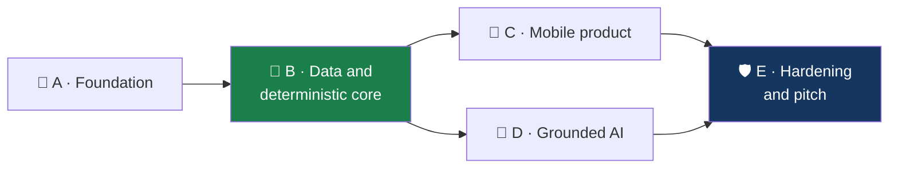

# Implementation plan — FinSight-AI

Derived from the [project scope](FinSight-AI-Project-Scope.md). The scope is the source of
truth for requirements and acceptance criteria (P0-01 … P0-12); this plan turns it into an
order of work and an owner for each piece.

**Rule for the whole build:** finish P0 before touching P1. Cut features before cutting
accuracy or evidence.

---

## Where we are

|         |                                                                               |
| ------- | ----------------------------------------------------------------------------- |
| ✅ Done | Repository, branches, CI and security pipeline, licence, conventions          |
| ✅ Done | Next.js 16 + TypeScript strict scaffold; lint, typecheck, test and build pass |
| ✅ Done | Integer-cent money parsing and field-level encryption, both tested            |
| ⏭️ Next | Milestone A remainder: database connection, schema, migrations                |

## Sequence

C and D run in parallel once B has agreed the shared contracts. That is the point where two
people stop blocking each other.

## Ownership (proposed — adjust at the first stand-up)

| Workstream                                                       | Owner    | Branch                   |
| ---------------------------------------------------------------- | -------- | ------------------------ |
| Data, database, encryption, analytics, AI tools                  | Eric     | `eric`                   |
| Mobile UI, evidence and assumption sheets, charts, accessibility | Tom      | `tom`                    |
| Booth questions, decision log, teaching copy, demo script, pitch | Jennifer | pull requests into `dev` |

---

## Milestone A — Foundation (2–3 h)

| #   | Task                                                                                                                                                                       | Owner | Req.         |
| --- | -------------------------------------------------------------------------------------------------------------------------------------------------------------------------- | ----- | ------------ |
| A1  | ~~Scaffold, scripts, env template, CI, security pipeline~~ ✅                                                                                                              | Eric  | P0-12        |
| A2  | Add Drizzle and the Postgres driver; `DATABASE_URL` with `sslmode=verify-full`                                                                                             | Eric  | P0-12        |
| A3  | Environment validation at startup (schema, no values printed)                                                                                                              | Eric  | P0-12        |
| A4  | Schema and first migration: `ingestions`, `customers`, `accounts`, `transactions`, `demo_sessions`, `classification_rules` — sealed columns per [database.md](database.md) | Eric  | P0-02        |
| A5  | `pnpm db:migrate`; least-privilege roles documented                                                                                                                        | Eric  | P0-12        |
| A6  | App shell: bottom navigation (Coach · My money · Explore), synthetic-data banner, as-of date                                                                               | Tom   | P0-08, P0-11 |
| A7  | shadcn/ui + Lucide installed; design tokens; 390 px layout checked at 320 px                                                                                               | Tom   | P0-08        |

**Exit gate:** app boots; `pnpm check` green; migration applies to an empty database.

## Milestone B — Data and deterministic core (6–8 h)

| #   | Task                                                                                                                                                                 | Owner      | Req.         |
| --- | -------------------------------------------------------------------------------------------------------------------------------------------------------------------- | ---------- | ------------ |
| B1  | **Shared contracts first:** Zod schemas for `CoachResult`, `MoneyFact`, `EvidenceRef`, card payloads in `src/lib/contracts/` — reviewed by both before anything else | Eric + Tom | P0-07        |
| B2  | `scripts/profile-data.ts`: counts, ranges, null rates, LFS-pointer detection                                                                                         | Eric       | P0-02        |
| B3  | `scripts/ingest.ts`: streaming CSV, BOM, explicit headers, timestamp parser (`03OCT24:09:04:04`), cents, encrypt on write, staging then promote, idempotent          | Eric       | P0-02        |
| B4  | Ingestion report in `data/derived/` (git-ignored): checksum, counts, rejects                                                                                         | Eric       | P0-02        |
| B5  | `DemoContext`: server-owned as-of date, coverage, "last month" and "this week" semantics                                                                             | Eric       | P0-11        |
| B6  | Customer-scoped repository: fetch by blind index, decrypt in memory                                                                                                  | Eric       | P0-01, P0-09 |
| B7  | Spending summary: category / MCC filters, signed totals, transaction count                                                                                           | Eric       | P0-03        |
| B8  | Cash-flow classification: consumption vs investment vs salary sweep vs income                                                                                        | Eric       | P0-03        |
| B9  | Basket mapper: versioned rules, regularity × necessity, explicit unclassified, reconciliation                                                                        | Eric       | P0-04        |
| B10 | Scenario engine: reduction in basis points, one rounding per scenario                                                                                                | Eric       | P0-06        |
| B11 | Forecast engine: minimum-over-horizon headroom, `needs_input` / `shortfall` / `insufficient_data`                                                                    | Eric       | P0-05        |
| B12 | Golden tests in integer cents for B7–B11, plus no-future-leakage tests                                                                                               | Eric       | P0-03–06     |
| B13 | Persona selection script: 2–3 customers chosen from pre-cutoff history                                                                                               | Eric       | P0-01        |
| B14 | Build screens against fixture responses that match the B1 contracts                                                                                                  | Tom        | P0-08        |

**Exit gate:** ingestion runs twice with identical totals; every golden test passes.

## Milestone C — Mobile product (6–7 h)

| #   | Task                                                                                          | Owner      | Req.     |
| --- | --------------------------------------------------------------------------------------------- | ---------- | -------- |
| C1  | Demo entry: persona selector, coverage, session cookie (`POST /api/demo/session`)             | Tom + Eric | P0-01    |
| C2  | My money: recorded balance, period selector, three basket cards, non-consumption flows        | Tom        | P0-04    |
| C3  | Explore: restaurant-reduction slider, baseline month, hypothetical saving                     | Tom        | P0-06    |
| C4  | Evidence sheet: filters, dates, count, paginated transactions, calculation note               | Tom        | P0-07    |
| C5  | Assumptions sheet: protected cash, essential reserve, horizon, confirmations                  | Tom        | P0-05    |
| C6  | Coach shell: conversation, prompt chips, typed result cards, stop / retry                     | Tom        | P0-08    |
| C7  | Route handlers: `overview`, `transactions`, `baskets`, `forecast`, `scenarios`, `assumptions` | Eric       | P0-03–06 |
| C8  | Empty, loading and error states on every screen                                               | Tom        | P0-10    |

**Exit gate:** the full journey works on a phone **with AI switched off**.

## Milestone D — Grounded AI (5–6 h)

| #   | Task                                                                                                 | Owner           | Req.  |
| --- | ---------------------------------------------------------------------------------------------------- | --------------- | ----- |
| D1  | Confirm with the bank that aggregates may be sent to a model; record in [decisions.md](decisions.md) | Jennifer        | P0-09 |
| D2  | Deterministic intent router for prompt chips (works with no key)                                     | Eric            | P0-10 |
| D3  | Provider adapter behind a small interface; model chosen by environment                               | Eric            | P0-09 |
| D4  | Tool registry: six allowlisted read-only tools calling the same analytics as the UI                  | Eric            | P0-09 |
| D5  | Bounded loop: 4 steps, 8 tool calls, 20 s timeout; validated final response                          | Eric            | P0-09 |
| D6  | Cards render numbers from tool results; model text references fact IDs only                          | Eric + Tom      | P0-07 |
| D7  | Fallback on missing key, denied permission, timeout, 429                                             | Eric            | P0-10 |
| D8  | Evaluation set of 20 prompts with expected tools and facts                                           | Jennifer + Eric | P0-09 |

**Exit gate:** ≥ 18 / 20 evaluation prompts correct; zero fabricated figures; every
cross-customer attempt blocked.

## Milestone E — Hardening and pitch (5–6 h)

| #   | Task                                                                              | Owner    | Req.  |
| --- | --------------------------------------------------------------------------------- | -------- | ----- |
| E1  | Playwright phone-sized end-to-end test of the main journey                        | Tom      | P0-08 |
| E2  | Accessibility pass: focus, labels, contrast, keyboard, reduced motion             | Tom      | P0-08 |
| E3  | Security pass: cross-customer IDs, forged result IDs, persona switch, rate limits | Eric     | P0-09 |
| E4  | Latency check: analytics p95 < 500 ms warm, AI median < 5 s                       | Eric     | —     |
| E5  | Deploy: hosted database in the EU, secrets set, `DEPLOY_ENABLED=true`             | Eric     | P0-12 |
| E6  | Demo script, backup recording, integration-boundary note                          | Jennifer | —     |
| E7  | Freeze: dataset version, as-of date, personas, prompt sequence                    | All      | P0-11 |

**Exit gate:** production build deployed; three-minute demo rehearsed twice end to end.

---

## Cut order, if time runs short

Voice → benchmarks → mortgage → multi-bank → saved goals → Finnish. Never cut accuracy or
evidence. The smallest honest demo is one customer, three chat questions, the basket view
and one scenario — described as a reduced prototype.

## Daily rhythm

1. Start: `git switch <your-branch> && git pull && git merge origin/dev`
2. Work in small commits; run `pnpm check` before pushing.
3. Open a pull request into `dev` as soon as a task works — small and often.
4. Promote `dev` → `main` at each milestone exit gate.

## Open decisions that block work

Tracked in [decisions.md](decisions.md). The two that block the most: whether aggregates
may be sent to an external model (blocks D3–D8), and how groceries fit the baskets
(blocks final sign-off of B9).
