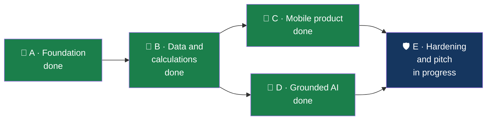

# Implementation plan — FinSight-AI

Where the build stands, what is left, and who owns it. The
[project scope](FinSight-AI-Project-Scope.md) remains the source of the original
requirements (P0-01 … P0-12).

Updated 14 November 2026.

---

## Where we are

Everything below is on the `eric` branch, with a pull request open into `dev`.

## The scope's P0 requirements

| ID    | Requirement                                      | Status | Where                                                                    |
| ----- | ------------------------------------------------ | ------ | ------------------------------------------------------------------------ |
| P0-01 | Synthetic demo session; no cross-customer access | ✅     | Session cookie, blind-index lookup, tools without a customer parameter   |
| P0-02 | Reproducible ingestion                           | ✅     | `scripts/ingest.ts`: streaming, BOM, checksum, LFS-pointer check, report |
| P0-03 | Spending questions                               | ✅     | `spending`, `trend`; evidence sheet                                      |
| P0-04 | Three baskets                                    | ✅     | `baskets`; every purchase in exactly one, totals reconcile (tested)      |
| P0-05 | Spending estimate                                | ✅     | `safe_to_spend`; shortfall shown separately                              |
| P0-06 | What-if saving                                   | ✅     | `what_if`; exact to the cent (tested)                                    |
| P0-07 | Evidence and teaching                            | ✅     | Transactions behind every figure; a lesson with each answer              |
| P0-08 | Mobile conversation                              | ✅     | Checked at 390 px and 320 px, no sideways scroll                         |
| P0-09 | Safe AI orchestration                            | ✅     | Validated tools, consent, grounding check, limits                        |
| P0-10 | Model failure behaviour                          | ✅     | Basic mode answers when the model is off, slow or failing                |
| P0-11 | Honest demo state                                | ✅     | Synthetic-data label and demo date on every screen                       |
| P0-12 | Reproducible delivery                            | 🟡     | Passes locally; CI runs on the pull request into `dev`                   |

One difference from the scope: the estimate uses assumptions suggested from the customer's
history instead of asking the customer to confirm each one first. They are labelled as
suggestions and listed in the answer.

## The scope's P1 and stretch items

| Item                                  | Status | Where                                                                            |
| ------------------------------------- | ------ | -------------------------------------------------------------------------------- |
| P1 · User corrections with undo       | ✅     | Basket corrections per purchase or kind; bill adjustments; originals kept        |
| P1 · Safe-to-save simulation          | ✅     | `safe_to_save`; set-asides capped at the safe amount; nothing is moved           |
| P1 · Finnish localisation             | ✅     | Finnish and Swedish throughout; needs a native review                            |
| P1 · Focused coaching goal            | ✅     | Goals from conversation or a form, with progress and pace                        |
| P2 · Population benchmark             | ✅     | Statistics Finland 2022, per consumption unit, by age group                      |
| P2 · Multi-bank adapter demonstration | ✅     | Linked accounts from made-up banks, labelled simulated, merged into every figure |
| P2 · Mortgage educational story       | ✅     | Guide from the 200 applications; the customer's own; no prediction               |
| P2 · Voice and installability         | ✅     | Spoken questions, realtime call, home-screen install                             |

## Beyond the scope

Added during the build, at the team's request.

| Feature                                                                | Status                                                         |
| ---------------------------------------------------------------------- | -------------------------------------------------------------- |
| Fifteen chart types; add-widget form; drag, resize, minimise, remove   | ✅                                                             |
| Shortcut widgets: ask by voice, call the coach, afford, story, goals   | ✅ The microphone and call shortcuts have not been spoken into |
| Saved dashboard views; period filter with custom dates                 | ✅                                                             |
| Plans shared as percentages, by code or publicly                       | ✅                                                             |
| Subscriptions view                                                     | ✅ By merchant number: the data has no payee names             |
| Recommendations, rewards and example coupons                           | ✅                                                             |
| Insights; device notifications and daily reminders                     | ✅ Real delivery to a phone has not been tried                 |
| "My month in 30 seconds" story                                         | ✅                                                             |
| Hand-over to a human adviser with a booked call                        | ✅                                                             |
| Admin: eleven sections, staff accounts with roles, charts, recycle bin | ✅                                                             |
| Teach the coach: staff-written answers for what it could not answer    | ✅                                                             |
| Terms and privacy at first sign-in; AI consent; export and erasure     | ✅                                                             |
| Recycle bin, restore and permanent delete for everything creatable     | ✅                                                             |
| Step-by-step forms with hints and suggestions; confirmations           | ✅                                                             |
| Light, dark and system themes; four text sizes; responsive from 320 px | ✅                                                             |
| Narrated product demo video                                            | ✅ `docs/media/finsight-demo.mp4`                              |

### Where we went past the scope's non-goals, on purpose

The scope excluded push notifications, social comparison and streak-style mechanics. The
team chose to build device reminders, shared plans and rewards. Each is opt-in or
switchable in Admin, reminders carry no amounts, shared plans carry percentages only, and
rewards compare a customer only with their own past. Real connectivity to other banks
remains a non-goal: linked accounts are a labelled simulation.

## What is left

| #   | Task                                                                           | Owner                   | Notes                                                                |
| --- | ------------------------------------------------------------------------------ | ----------------------- | -------------------------------------------------------------------- |
| 1   | Get CI green on the pull request `eric` → `dev`, then promote `dev` → `main`   | Eric, team              | Vercel deploys from `main`                                           |
| 2   | Add `VAPID_PUBLIC_KEY`, `VAPID_PRIVATE_KEY`, `CRON_SECRET` in Vercel           | Eric                    | Device notifications and the daily reminder job                      |
| 3   | Hostinger DNS record for `finsightai.araxda.com`                               | Eric                    |                                                                      |
| 4   | Rehearse the voice call with a real voice in Finnish and Swedish               | Anyone Finnish-speaking | Only the connection and the greeting are verified                    |
| 5   | Native review of Finnish and Swedish texts                                     | Team                    | Especially financial terms, the terms of use, and the newest screens |
| 6   | Install on an iPhone and an Android phone; try a real notification             | Tom                     |                                                                      |
| 7   | Rehearse the three-minute demo twice                                           | All                     | [demo-script.md](demo-script.md)                                     |
| 8   | Ask the bank the open questions                                                | Jennifer                | [decisions.md](decisions.md)                                         |
| 9   | Set strong `ADMIN_PASSWORD` and `DEMO_LOGIN_PASSWORD`; keep the daily AI limit | Eric                    | Before sharing the link                                              |

The hosted database is migrated up to 008 and the mortgage files are loaded.

## Ideas not built

1. Goal progress as a curve over months: the demo date is fixed and the data ends two
   weeks after it, so progress shows as an amount and a pace, not a history.
2. A real connection to other banks (PSD2). Out of scope for a prototype.
3. Matching a transfer out of one account with the transfer into another, so money moved
   between a customer's own accounts is recognised as such.
4. Second-factor or single sign-on for staff.

## Cut order, if something has to go before the demo

Voice call → adviser hand-over → rewards → Swedish. Never the evidence behind an answer or
basic mode.

## Working rhythm

1. `git switch <your-branch> && git pull && git merge origin/dev`
2. Small commits; `pnpm check` before pushing.
3. Pull request into `dev` as soon as something works.
4. Promote `dev` → `main` when the demo flow passes end to end.
