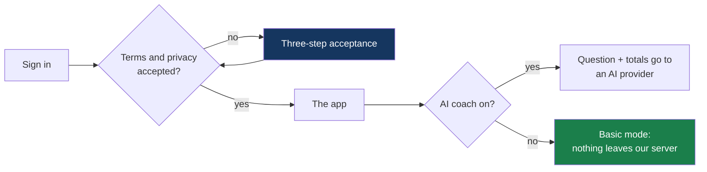

# Privacy and data protection — FinSight-AI

How the service is designed to meet the principles of the EU General Data Protection
Regulation (GDPR). The prototype runs on synthetic data, so no real personal data is
processed today; these are the controls a real deployment would build on.

> This is an engineering description, not legal advice or a compliance certification. A
> real launch needs the bank's data protection officer, a data protection impact
> assessment, and data processing agreements with each provider.

---

## Principles and how they are met

| GDPR principle                | In the product                                                                                                                                                               |
| ----------------------------- | ---------------------------------------------------------------------------------------------------------------------------------------------------------------------------- |
| Lawfulness and transparency   | Terms of use and a plain-language privacy notice, in English, Finnish and Swedish, accepted at first sign-in. The AI coach is a separate choice                              |
| Purpose limitation            | Data is used only to show and explain the customer's own finances                                                                                                            |
| Data minimisation             | The AI model receives the question and totals. Never the transaction list, customer ID, account number, age or postal code. Admin statistics hold counts, not people or text |
| Accuracy                      | Every figure is calculated from the source transactions, links to the transactions behind it, and the model's wording is checked against it                                  |
| Storage limitation            | Sessions end after 8 hours; conversations are not stored; what the customer saves lives until they delete it                                                                 |
| Integrity and confidentiality | Field-level encryption with per-customer keys, blind-index lookup, TLS, hashed session tokens (see [security.md](security.md))                                               |
| Accountability                | Consent is versioned and timestamped for acceptance and withdrawal; staff actions are written to an audit log                                                                |

## What the customer agrees to, and when

- **Terms of use and the privacy notice** are required. Until they are accepted, the server
  refuses every request for the customer's data.
- **AI processing** is optional and off until the customer says yes. Saying no still gives a
  working coach. The choice can be changed in Settings at any time and takes effect on the
  next question.
- **Voice** uses a speech provider, so it needs the same yes.
- **Talking to an adviser** shares only what the customer writes in that request.
- Both the terms and the AI terms carry a version. Changing a version asks again.

## Data subject rights

| Right                         | Where                                                                                                                                                |
| ----------------------------- | ---------------------------------------------------------------------------------------------------------------------------------------------------- |
| Information                   | `/privacy` and `/terms`, linked from the first sign-in and from Settings                                                                             |
| Access and portability        | Settings → _Download my data_: one JSON file with profile, transactions and their classification, saved views, goals, recycle bin and consent record |
| Erasure                       | Settings → _Delete my app data_: saved views, goals, recycle bin, read insights, adviser conversations, the consent record and all sessions          |
| Rectification of app data     | Goals and views can be edited; deleted items can be restored                                                                                         |
| Withdraw consent              | Settings → _AI coach_                                                                                                                                |
| No solely automated decisions | The coach explains and estimates; it makes no decision with legal or similar effect. A human adviser can be asked for                                |

The transaction ledger is the bank's record. In a real deployment its erasure follows the
bank's retention rules; because each customer's data is sealed with their own derived key,
retiring that key makes it unreadable everywhere, including in backups.

## Who receives what

| Receiver                                 | Receives                                                                                                                                                                                                | Only when                                               |
| ---------------------------------------- | ------------------------------------------------------------------------------------------------------------------------------------------------------------------------------------------------------- | ------------------------------------------------------- |
| Language model (OpenAI or Google Gemini) | The question, recent conversation turns, and totals and summaries from the calculations                                                                                                                 | The AI coach is on in Admin and the customer has agreed |
| ElevenLabs, speech                       | The recording of a spoken question; the text of an answer to be read aloud                                                                                                                              | Voice is used and the customer has agreed               |
| ElevenLabs, voice call                   | The live audio of the call; the question as heard; the answer text our coach returned. The call is run by an ElevenLabs agent, which uses a language model on ElevenLabs' side to hold the conversation | A voice call is started and the customer has agreed     |
| Database host                            | Ciphertext, blind indexes and anonymous counters                                                                                                                                                        | Always                                                  |
| A bank adviser                           | The topic, the chosen call time, the customer's note and messages, under a pseudonym                                                                                                                    | The customer requests an adviser                        |

None of them receives the transaction list, the customer ID, the account number, age or
postal code.

Before real data: sign data processing agreements, choose EU data residency and
zero-retention options where the provider offers them, and document international transfers.

## What staff can see

- **Counts**: how many questions per topic, language and day; how many consents; how many
  goals. Never who, and never the text.
- **Themes** of questions the coach could not calculate. The question is reduced to a theme
  when it arrives and is not kept.
- **Announcement reach**: how many customers saw each one, not which.
- **Adviser requests**: what the customer chose to share, under a pseudonym.
- **Shared plans**: the name and percentages a customer published, not who published them.
- **Not** a customer's transactions, balance or profile. No admin route returns them.

## Linked accounts

Accounts at other banks are simulated in this prototype: no bank is contacted, no
credential is asked for, and the transactions are generated. The screen says so before
linking and on every chart afterwards. A real service would need each bank's
account-information access under PSD2, the customer's explicit consent at that bank,
renewal of that consent, and its own data-protection assessment.

## Corrections and set-asides

The customer's corrections and the amounts they mark as set aside are their own data,
sealed with their key, exported with their data and erased with it. What the app had
worked out is never overwritten, so every correction can be undone.

## Mortgage records

Customers with a mortgage application in the dataset can see their own history and
outcome; nobody else can. The guide's general figures are medians and counts over all 200
applications. The app explains outcomes and never produces a score, a prediction or a
decision about lending.

## Sharing plans

Sharing is the customer's own, deliberate act, and it publishes the minimum: a plan's name
and five whole percentages. No amount exists in a plan to be shared. Goal names are hidden
unless the customer chooses to show them. The published record is not linked to the
customer, can be withdrawn at any time, and is withdrawn automatically when the plan is
deleted. Before publishing, the customer is shown exactly what others will see.

## Device notifications

Asked once, on first use; switched on or off in Settings. A notification carries a title
only. Withdrawing removes the device's subscription.

## Rewards

Rewards compare a customer with their own earlier months, never with other customers, and
never score or rank a person. Peer comparisons use percentiles of groups of at least 30.

## Still required before real customers

- A data protection impact assessment (the service profiles financial behaviour)
- The bank's lawful-basis decision and records of processing
- Processor agreements and transfer assessments for the AI and speech providers
- Breach response and retention procedures
- Strong customer authentication in place of the demo sign-in
- Individual staff accounts for advisers, with access to adviser requests logged per person
