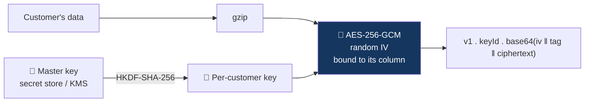

# Security model — FinSight-AI

FinSight-AI handles banking-shaped data, so it is built to the standard a bank would expect
even though the dataset is synthetic. This document is the rulebook; the
[pull request template](../.github/pull_request_template.md) asks you to confirm it on every
change.

> These are engineering controls for a prototype. They are not a compliance certification
> and do not replace a bank's own security, privacy and legal review. What is still missing
> for real customers is listed at the end.

---

## 1. Nothing is stored bare

No customer or transaction value is written to the database in plaintext.

| Layer           | Control                                                        | Protects against                                                                          |
| --------------- | -------------------------------------------------------------- | ----------------------------------------------------------------------------------------- |
| In transit      | TLS on every connection; PostgreSQL with `sslmode=verify-full` | Network interception                                                                      |
| At rest (disk)  | Provider-managed volume and backup encryption                  | Stolen disks and snapshots                                                                |
| At rest (field) | Application-level AES-256-GCM on everything a customer owns    | Database dumps, leaked backups, over-privileged database accounts, SQL injection read-out |
| Identifiers     | HMAC-SHA-256 blind indexes instead of raw customer IDs         | Linking a row to a customer without the key                                               |
| Sessions        | Only a keyed hash of the session token is stored               | Session theft from a database read                                                        |
| Rate-limit keys | Stored as keyed hashes                                         | Leaking addresses or account IDs                                                          |

Implementation: [`crypto.ts`](../src/lib/security/crypto.ts),
[`keys.ts`](../src/lib/security/keys.ts), [`ledger-codec.ts`](../src/lib/data/ledger-codec.ts).

- **Authenticated.** A modified value fails to decrypt.
- **Bound to its column.** A ciphertext copied into another column, or under another
  customer, is rejected. There is a test that moves one customer's ciphertext under another
  and checks that it fails.
- **Per-customer keys**, derived from the master key. One customer's key cannot read
  another's rows. Retiring a key makes that customer's data unreadable everywhere, backups
  included.
- **Rotatable.** Each ciphertext carries the ID of the key that sealed it.

### What is encrypted

| Data                                                           | Storage                                                     |
| -------------------------------------------------------------- | ----------------------------------------------------------- |
| Customer ID                                                    | Blind index for lookup; sealed copy in the profile          |
| Account ID, age, postal code                                   | Sealed in the profile                                       |
| Every transaction                                              | Sealed together as one compressed ledger per customer       |
| Saved views, goals, recycle bin, read insights, consent record | Sealed per customer                                         |
| Adviser requests and messages                                  | Sealed with the customer's key                              |
| Session token                                                  | Keyed hash only                                             |
| Usage statistics                                               | Plain — daily counts with no customer reference and no text |
| Peer benchmarks                                                | Plain — percentiles over groups of 30 or more               |
| Announcements, admin settings, audit log                       | Plain — written by staff, not customer data                 |

Encrypted values cannot be summed in SQL. That is fine here: a customer has at most about
1,500 transactions, so a request fetches their one sealed ledger, decrypts it in memory and
calculates in the application. No query ever spans customers.

### Keys

- `DATA_ENCRYPTION_KEY` and `BLIND_INDEX_KEY` are 32 random bytes each, and must differ.
- They live in the host's secret store. Never committed, logged, sent to the browser or
  stored in the database they protect.
- Changing either makes already-loaded data unreadable. Re-run the ingestion after a change.
- Losing the key means losing the data. Back it up separately from the database.
- In a bank deployment the master key moves into a KMS or HSM.

---

## 2. Who is asking

- The customer is taken from the **server session**, never from a URL, request body, chat
  message or model tool input ([`context.ts`](../src/lib/coach/context.ts)).
- Every repository function takes that customer's blind index.
- Tools given to the model have **no customer parameter**. A prompt asking for another
  customer's data has nothing to call.
- A customer cookie gives no access to admin routes, and an admin cookie gives no access to
  customer routes.

## 3. Sessions and sign-in

- Opaque random token in an `HttpOnly`, `SameSite=Lax` cookie, `Secure` in production.
  Expires after 8 hours. Signing out deletes it server-side.
- Sign-in is limited to 10 attempts a minute per address and 8 per 15 minutes per account.
- A wrong password and an unknown customer give the same response.
- The demo sign-in (customer ID and a shared password) exists only because the data is
  synthetic. It is not authentication and must be replaced before any real use.
- **Admin** uses a separate password and a signed, expiring cookie (`SameSite=Strict`),
  limited to 5 attempts a minute. In production a password shorter than 12 characters is
  refused. Failed admin sign-ins are written to the audit log.

## 4. Terms before data

Every route that shows or changes customer data refuses with `403 terms_required` until the
customer has accepted the current terms of use and privacy notice. The interface shows the
acceptance steps first, but the check is on the server.

## 5. Requests

- **Cross-site requests are refused.** Any state-changing API request whose `Origin` names
  another site gets `403` ([`proxy.ts`](../src/proxy.ts)). With `SameSite` cookies, another
  website cannot act with a visitor's session.
- **Every input is validated** with a schema; unknown tools and out-of-range values are
  rejected.
- **Parameterised SQL only.**
- **Rate limits** on sign-in, chat, speech, voice calls and adviser messages. They are
  counted in the database, so they hold across server instances.
- **Bounded responses**: transaction lists are paged, at most 100 a page.
- **Security headers** on every response: Content-Security-Policy, HSTS, `nosniff`,
  frame restrictions, Referrer-Policy, Permissions-Policy
  ([`next.config.ts`](../next.config.ts)).

## 6. The AI

| Rule                                     | How it is enforced                                                                                                                                                               |
| ---------------------------------------- | -------------------------------------------------------------------------------------------------------------------------------------------------------------------------------- |
| Off unless the customer said yes         | Consent is checked on the server for every question                                                                                                                              |
| Sees totals, never transactions          | Tool results passed to the model contain summaries and facts only                                                                                                                |
| Sees no identity                         | No customer ID, account, age or postal code is sent                                                                                                                              |
| Cannot reach other customers             | Tools have no customer parameter                                                                                                                                                 |
| Cannot run SQL, read files or fetch URLs | Eleven fixed calculations and two goal tools. The only thing a tool can write is the customer's own savings goal                                                                 |
| Bounded                                  | At most four tool steps and a 20-second timeout                                                                                                                                  |
| Cannot invent a figure                   | Its wording is checked against the calculation; an unsupported amount replaces the wording with the calculation's own sentence ([`grounding.ts`](../src/lib/coach/grounding.ts)) |
| Has a budget                             | A daily limit set in Admin; beyond it the coach uses basic mode                                                                                                                  |
| Can be switched off                      | One switch in Admin; every customer gets basic mode within seconds                                                                                                               |

The conversation history is sent by the browser with each question and is treated as
untrusted text. It cannot grant access to anything: whatever it says, the tools still act
only for the signed-in customer.

### Voice

- The ElevenLabs API key never reaches the browser.
- A voice call uses a short-lived signed address issued by our server, and the agent
  requires one: its ID alone is not enough to use it.
- The agent has no data and no credentials. Its only tool runs in the customer's browser
  and calls our coach with their session.

## 7. Admin

- Reads aggregates only. No admin route opens a customer's transactions.
- Usage statistics are counts per day and topic: no customer reference, no question text.
- Questions outside the coach's scope are reduced to a theme on arrival; the text is not
  kept.
- Adviser requests show a pseudonym and only what the customer chose to share.
- Every change is written to the audit log.

## 8. Secrets and data in the repository

- No `.env` files, keys, tokens or connection strings in git. `.env.example` has names and
  placeholders only.
- Server secrets never use the `NEXT_PUBLIC_` prefix.
- The bank's files and anything derived from them are never committed. Test fixtures are
  hand-authored.
- GitHub secret scanning and push protection are on.
- If a secret is exposed: **rotate it first**, then tell the maintainer.

## 9. Logging

Logs record the route, status and duration. They never contain secrets, connection strings,
decrypted values, questions or transactions.

## 10. Pipeline

| Check                                 | Where                                                         |
| ------------------------------------- | ------------------------------------------------------------- |
| Lint, format, typecheck, tests, build | [`pr-validation.yml`](../.github/workflows/pr-validation.yml) |
| Only `dev` may be promoted to `main`  | [`pr-validation.yml`](../.github/workflows/pr-validation.yml) |
| CodeQL static analysis                | [`security.yml`](../.github/workflows/security.yml)           |
| Dependency review and audit           | [`security.yml`](../.github/workflows/security.yml)           |
| Dependency updates                    | [`dependabot.yml`](../.github/dependabot.yml)                 |

## 11. What the tests prove

`pnpm test` runs the real migrations on an in-memory PostgreSQL and checks, among others:

- no customer ID, category, amount or postal code appears in any stored column
- one customer's saved state cannot be opened under another customer
- AI consent does not count until the terms are accepted
- rate limits refuse after the limit and store only hashed keys
- the usage table has no column that could hold a customer or a question
- adviser requests are sealed, pseudonymous, and can only be deleted from the bin
- an amount the calculation did not produce is caught by the grounding check

## 12. Known limits

Be straight about these when asked.

- **Demo authentication.** One shared password for all synthetic customers.
- **Content-Security-Policy allows inline scripts**, which the framework needs without a
  nonce set-up.
- **Keys are environment variables**, not in a KMS.
- **No penetration test** has been done.
- **Adviser role is the admin password.** There are no individual staff accounts.
- **In demo mode the sign-in page shows the demo password** on purpose.

## 13. Before real customers

Bank authentication and authorisation, individual staff accounts with roles, a KMS or HSM,
audited key access, retention and deletion procedures, penetration testing, approved model
hosting with data processing agreements, and the bank's security, privacy and legal review.
