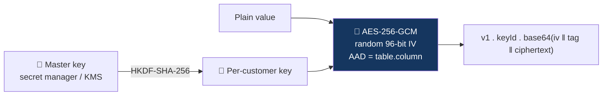

# Security model — FinSight-AI

FinSight-AI handles banking-shaped data, so it is built to the standard a bank would expect
even though the hackathon dataset is synthetic. This document is the rulebook; the
[pull request template](../.github/pull_request_template.md) asks you to confirm it on
every change.

> These are engineering controls for a prototype. They are not a compliance certification
> and do not replace a bank's own security, privacy and legal review.

---

## 1. The core rule: nothing is stored bare

No customer or transaction value is written to the database in plaintext.

| Layer           | Control                                                      | Protects against                                                                    |
| --------------- | ------------------------------------------------------------ | ----------------------------------------------------------------------------------- |
| In transit      | TLS on every connection; Postgres with `sslmode=verify-full` | Network interception                                                                |
| At rest (disk)  | Provider-managed AES-256 volume and backup encryption        | Stolen disks and snapshots                                                          |
| At rest (field) | Application-level AES-256-GCM on every sensitive column      | Database dumps, leaked backups, over-privileged DB accounts, SQL injection read-out |
| Identifiers     | HMAC-SHA-256 blind indexes instead of raw IDs                | Linking rows to a customer without the key                                          |
| Sessions        | Only a hash of the session token is stored                   | Session theft from a database read                                                  |

Implementation: [`src/lib/security/crypto.ts`](../src/lib/security/crypto.ts), tested in
[`tests/unit/crypto.test.ts`](../tests/unit/crypto.test.ts).

### How field encryption works

- **Authenticated.** GCM detects any modification; a tampered value fails to decrypt.
- **Bound to its column.** The column name is authenticated data, so a ciphertext copied
  into another column or table is rejected.
- **Per-customer keys.** Derived from the master key with HKDF. One customer's key cannot
  read another customer's rows, and retiring a key makes that customer's data unreadable
  (crypto-shredding, which supports erasure requests).
- **Rotatable.** Each ciphertext carries the key ID it was sealed with.
- **Separate index key.** Blind indexes use a different key from encryption.

### What is encrypted

| Data                                                          | Storage                                             |
| ------------------------------------------------------------- | --------------------------------------------------- |
| Customer ID, account ID                                       | Blind index for lookup; encrypted copy for display  |
| Amount, balance                                               | Encrypted                                           |
| Date, timestamp                                               | Encrypted                                           |
| Category, transaction type, merchant ID, MCC                  | Encrypted                                           |
| Age, postal code                                              | Encrypted                                           |
| User assumptions and overrides                                | Encrypted                                           |
| Session token                                                 | SHA-256 hash only                                   |
| Row UUID, ingestion ID, source row number, key ID, created-at | Plain — technical metadata with no customer meaning |
| Classification rules, teaching glossary                       | Plain — product configuration, not customer data    |

### Why this still performs

Encrypted values cannot be summed or filtered in SQL. That is acceptable here because the
data is naturally partitioned: the dataset has between 148 and 1,543 transactions per
customer. A request fetches one customer's rows by blind index, decrypts them in memory and
runs the analytics in the application. Nothing is decrypted in the database, and no query
ever spans customers.

### Keys

- `DATA_ENCRYPTION_KEY` and `BLIND_INDEX_KEY` are 32 random bytes each
  (`openssl rand -base64 32`), and must differ.
- Keys live in the hosting platform's secret store. They are never committed, never logged,
  never sent to the browser, and never stored in the database they protect.
- In a bank deployment the master key moves into a KMS or HSM (envelope encryption): the
  application asks the KMS to unwrap a data key and never holds the root key.
- Losing the key means losing the data. Back the key up separately from the database.

---

## 2. Customer isolation

- The customer is derived from the **server session**, never from a URL, request body,
  chat message or model tool input.
- Every repository function takes a server-validated customer context and scopes its query
  to that customer's blind index.
- Cross-customer access is covered by tests that must pass on every commit.

## 3. Sessions

- Opaque, random, server-issued token in an `HttpOnly`, `Secure`, `SameSite=Lax` cookie.
- Short expiry. Switching persona clears the conversation and invalidates earlier results.
- The persona selector exists only because the data is synthetic. It is not authentication
  and must be replaced by the host's identity before any real use.

## 4. Input and output

- Validate every request at the boundary with a schema; reject unknown fields.
- Parameterised SQL only. No string-built queries.
- Bounded pagination (default 20, maximum 100) and request size limits.
- Treat merchant IDs, notes and all user text as untrusted data, never as instructions.
- Escape rendered text; do not render model output as raw HTML.
- Security headers (CSP, HSTS, `frame-ancestors`, `nosniff`, Referrer-Policy,
  Permissions-Policy) are set in [`next.config.ts`](../next.config.ts).

## 5. AI boundaries

- `AI_PROCESSING_ALLOWED=false` by default. No data leaves the application until the bank
  confirms it may.
- The model receives aggregates and short explanations only — never raw transaction
  histories, customer IDs, age or postal code.
- Tools are allowlisted and read-only: no SQL, no filesystem, no shell, no URLs, no
  customer ID parameter.
- At most four tool steps and eight tool calls per request, with a timeout.
- Every figure shown to the user comes from a server calculation, not from model text.

## 6. Secrets and data in the repository

- No `.env` files, keys, tokens or connection strings in git. `.env.example` holds names
  and placeholders only.
- Server secrets never use the `NEXT_PUBLIC_` prefix.
- The bank's CSV files and anything derived from them are never committed. Test fixtures
  are hand-authored.
- GitHub secret scanning and push protection are enabled on the repository.
- If a secret is exposed: **rotate it first**, then tell the maintainer.

## 7. Logging

- Log request ID, route, tool names, duration and status.
- Never log secrets, connection strings, decrypted values, prompts or transaction rows.

## 8. Pipeline

| Check                                 | Where                                                         |
| ------------------------------------- | ------------------------------------------------------------- |
| Lint, format, typecheck, tests, build | [`pr-validation.yml`](../.github/workflows/pr-validation.yml) |
| Only `dev` may be promoted to `main`  | [`pr-validation.yml`](../.github/workflows/pr-validation.yml) |
| CodeQL static analysis                | [`security.yml`](../.github/workflows/security.yml)           |
| Dependency review and audit           | [`security.yml`](../.github/workflows/security.yml)           |
| Dependency updates                    | [`dependabot.yml`](../.github/dependabot.yml)                 |

## 9. Outside the prototype

A real pilot would additionally need: bank-approved authentication and authorisation, a KMS
or HSM, audited access to keys, data-retention and deletion policies, penetration testing,
approved model hosting, and the bank's security, privacy and legal review.
